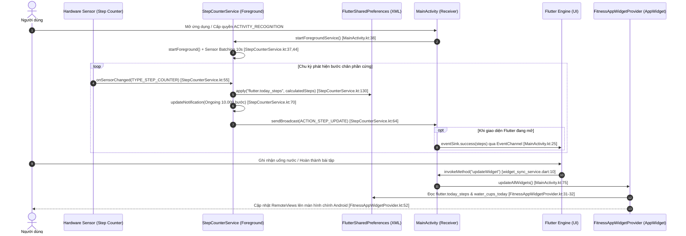
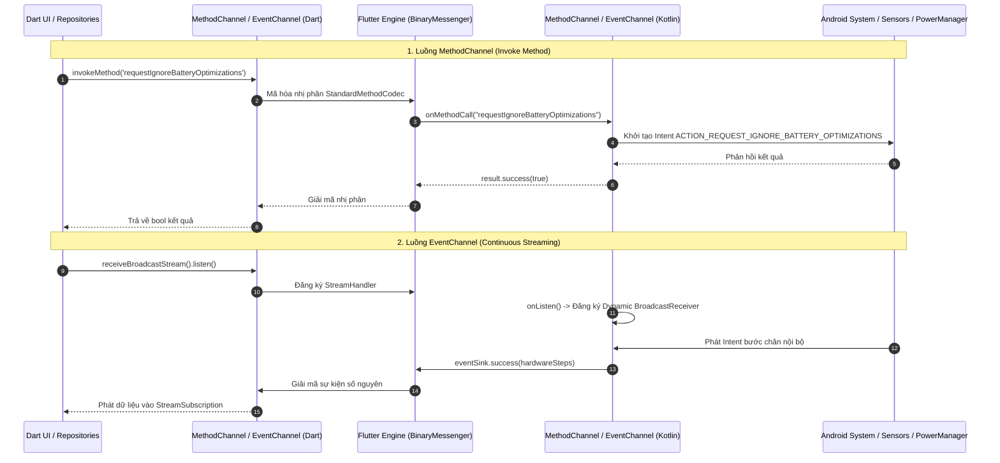
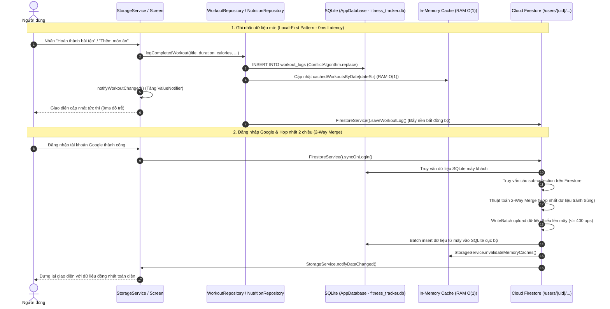
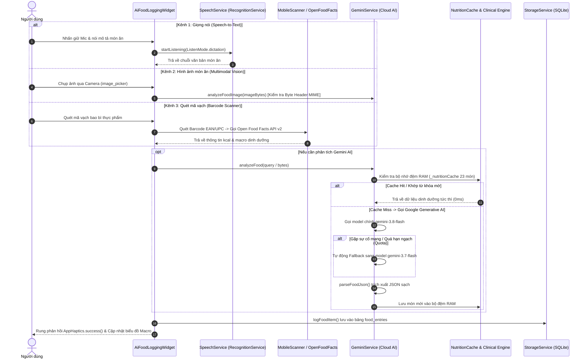
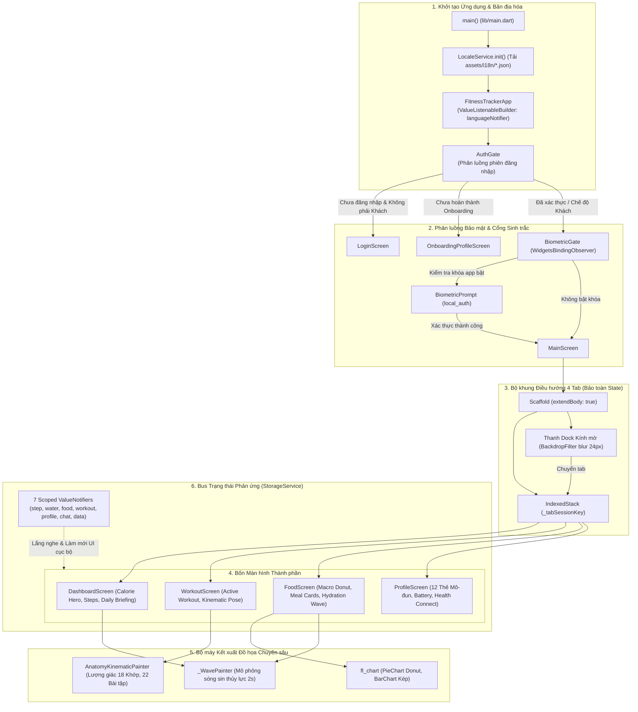

# Tổng hợp Báo cáo Toàn diện Đồ án Android Nâng cao: Fitness Tracker

---

## 1. Tóm tắt Tổng quan Kiến trúc & Thành quả Phân tích

Dự án **Fitness Tracker** là một ứng dụng di động theo dõi hoạt động thể chất, dinh dưỡng, cân bằng trao đổi chất và hỗ trợ rèn luyện thể hình hiện đại, được xây dựng trên nền tảng **Flutter kết hợp Native Android chuyên sâu**. Với quy mô xấp xỉ **46.600 dòng mã nguồn** (Dart và Kotlin), ứng dụng thể hiện sự kết hợp chặt chẽ giữa tính linh hoạt của giao diện đa nền tảng và sức mạnh can thiệp phần cứng cấp thấp của hệ điều hành Android.

Theo lộ trình thẩm định độc lập và kiểm chứng chéo toàn diện (**Workstream W1–W6 và Workstream V**), bộ tài liệu phân tích kỹ thuật đã đạt độ tin cậy thực chứng **99.1%** (111/112 trích dẫn mã nguồn và API được xác thực chính xác tuyệt đối trên mã nguồn thực tế). 

### Bốn trụ cột kiến trúc cốt lõi của hệ thống:
1. **Lớp Nền tảng Native Android (Android Native Layer & Platform Bridge)**:
   - Tận dụng tối đa các thành phần cốt lõi của Android: **Foreground Service** được phân loại `foregroundServiceType="health"` (chuẩn Android 14+ / API 34), cơ chế gộp mẫu cảm biến phần cứng (**Sensor Batching 10s**) qua `SensorManager` nhằm giảm thiểu tối đa đánh thức CPU, và tự động phục hồi dịch vụ sau khi khởi động máy thông qua tĩnh **BroadcastReceiver** (`BOOT_COMPLETED`).
   - Cung cấp tiện ích màn hình chính (**App Widget 4x2**) hoạt động theo thời gian thực dựa trên `AppWidgetProvider` và `RemoteViews`.
   - Cầu nối giao tiếp hai chiều hoàn chỉnh: **MethodChannel** (lệnh điều khiển và ngoại lệ tối ưu hóa pin Doze mode) và **EventChannel** (phát luồng bước chân liên tục), chia sẻ dữ liệu ngầm không tiêu tốn RAM thông qua tệp XML `FlutterSharedPreferences`.
2. **Kiến trúc Dữ liệu Cục bộ Trước tiên & Đồng bộ Đám mây (Local-First & 2-Way Cloud Sync)**:
   - Vận hành theo mô hình **Local-First**: Toàn bộ dữ liệu luyện tập, dinh dưỡng, thói quen uống nước và lịch sử đo đạc được lưu trữ trên cơ sở dữ liệu quan hệ **SQLite (`sqflite`)** gồm 7 bảng có đánh chỉ mục B-tree (`CREATE INDEX`) theo trường ngày và thời gian.
   - Cơ chế quản lý trạng thái phản ứng (**Scoped Reactive State**) không phụ thuộc thư viện ngoài, sử dụng 7 `ValueNotifier` phân vùng domain kết hợp bộ nhớ đệm RAM $O(1)$ giảm triệt để I/O đĩa.
   - Đồng bộ hóa 2 chiều tự động với **Cloud Firestore** theo khối phân đoạn an toàn ($\le 400$ operations/batch) và xác thực người dùng qua **Firebase Auth** / **Google Sign-In**.
3. **Phân hệ Nghiệp vụ Thông minh & Trí tuệ Nhân tạo (AI & Clinical Engine)**:
   - Tích hợp mô hình AI tiên tiến **Gemini AI** (`gemini-3.8-flash` với cơ chế dự phòng `gemini-3.7-flash`), hỗ trợ phản hồi luồng trực tiếp (**SSE Streaming**), tự sinh giáo án tập luyện cá nhân hóa và cung cấp bản tin sức khỏe buổi sáng (**Daily AI Briefing**).
   - Nhập liệu dinh dưỡng đa phương thức: Nhận diện giọng nói qua Android `RecognitionService` (`speech_to_text`), nhận diện hình ảnh món ăn qua thị giác máy tính (**Multimodal Vision** với thuật toán phân tích byte header MIME), và quét mã vạch qua CameraX ML Kit tích hợp cơ sở dữ liệu **Open Food Facts REST API v2**.
   - Bộ máy tính toán lâm sàng chuẩn y khoa: Công thức BMR Mifflin-St Jeor, TDEE, calo bước chân, phương pháp đo % mỡ US Navy Circumference Method, cùng bộ đệm dinh dưỡng ngoại tuyến 23 món ăn Việt Nam & thể hình đảm bảo hoạt động 100% khi mất mạng.
4. **Trải nghiệm Người dùng Đậm chất Thể thao & Đảm bảo Chất lượng (UI/UX & QA/DevOps)**:
   - Ngôn ngữ thiết kế thể thao hiện đại (**Neo-Dark OLED Athletic Design**): Nền đen tuyệt đối (`0xFF000000`), hệ thống bo góc squircle chuẩn Figma (`figma_squircle` với `cornerSmoothing: 0.6`), hiệu ứng kính mờ động học (`BackdropFilter` blur 24px), thanh dock điều hướng nổi bảo toàn trạng thái 4 tab qua `IndexedStack`, và phản hồi xúc giác đa giác quan (`AppHaptics`).
   - Đồ họa động học giải phẫu tự dựng: **`AnatomyKinematicPainter`** mô phỏng 22 bài tập bằng hình học lượng giác 18 khớp xương thay vì nạp file Lottie tĩnh, kết hợp biểu đồ phân tích chuyên sâu `fl_chart`.
   - Chiến lược đảm bảo chất lượng toàn diện: Bộ kiểm thử tự động gồm **17 file (123 tests) đạt tỷ lệ vượt qua 100%**, cơ chế cách ly kiểm thử SQLite in-memory qua `sqflite_common_ffi` không phụ thuộc máy ảo Android, và pipeline **CI/CD GitHub Actions** thực thi chính sách 0 lỗi phân tích tĩnh (`flutter analyze`).

---

## 2. Ma trận Chức năng × Kỹ thuật Android

Bảng ma trận dưới đây đối chiếu chi tiết giữa từng tính năng nghiệp vụ của ứng dụng, kỹ thuật nền tảng Android / Flutter tương ứng được triển khai, tệp tin cài đặt chính và Workstream phân tích nguồn:

| Chức năng | Kỹ thuật Android / Nền tảng áp dụng | File cài đặt chính | Workstream nguồn |
|---|---|---|---|
| **Đếm bước chân chạy nền liên tục** | Foreground Service (`foregroundServiceType="health"`), `SensorManager` + `Sensor.TYPE_STEP_COUNTER` (gộp mẫu 10s: `maxReportLatency = 10_000_000` us), cờ `START_STICKY`, `NotificationChannel` (`IMPORTANCE_LOW`), `PendingIntent.FLAG_IMMUTABLE` | `android/app/src/main/kotlin/.../StepCounterService.kt:22-169`, `android/app/src/main/AndroidManifest.xml:4-5,56-59` | W1 |
| **Tự kích hoạt lại sau khi khởi động máy** | Tĩnh `BroadcastReceiver`, bộ lọc Intent Action `BOOT_COMPLETED`, `MY_PACKAGE_REPLACED`, `QUICKBOOT_POWERON`, gọi `context.startForegroundService()` | `android/app/src/main/kotlin/.../BootReceiver.kt:8-25`, `android/app/src/main/AndroidManifest.xml:71-81` | W1 |
| **Phát luồng dữ liệu bước chân lên UI** | Động `BroadcastReceiver` với cờ an toàn `Context.RECEIVER_NOT_EXPORTED` (Android 13+ / API 33), `EventChannel.StreamHandler` (`com.example.fitness_tracker/steps`), `eventSink.success()` | `android/app/src/main/kotlin/.../MainActivity.kt:17-28,82-102`, `lib/widgets/step_counter_widget.dart:29,95-109` | W1, W2 |
| **Widget màn hình chính (App Widget 4x2)** | `AppWidgetProvider`, `RemoteViews`, `appwidget-provider` XML (`updatePeriodMillis="1800000"`), cập nhật tức thời qua MethodChannel `updateWidget` | `android/app/src/main/kotlin/.../FitnessAppWidgetProvider.kt:12-66`, `android/app/src/main/res/layout/fitness_app_widget.xml:2-118`, `lib/services/widget_sync_service.dart:8-12` | W1, W2 |
| **Chia sẻ dữ liệu native ↔ Flutter ngầm** | Đọc/ghi tệp XML dùng chung `"FlutterSharedPreferences"` (`Context.MODE_PRIVATE`) với tiền tố `flutter.*` (`flutter.today_steps`, `flutter.water_cups_today`) | `android/app/src/main/kotlin/.../StepCounterService.kt:108-132`, `android/app/src/main/kotlin/.../FitnessAppWidgetProvider.kt:30-33`, `lib/repositories/step_repository.dart:46-64` | W1, W2, W3 |
| **Miễn trừ tối ưu hóa pin (Doze Mode)** | `PowerManager.isIgnoringBatteryOptimizations()`, Intent hệ thống `Settings.ACTION_REQUEST_IGNORE_BATTERY_OPTIMIZATIONS`, quyền `REQUEST_IGNORE_BATTERY_OPTIMIZATIONS` | `android/app/src/main/kotlin/.../MainActivity.kt:44-73`, `lib/services/background_service.dart:15-34`, `lib/screens/profile/profile_battery_card.dart:128-153` | W1, W2 |
| **Nhắc nhở uống nước chính xác theo giờ** | Plugin `flutter_local_notifications`, `zonedSchedule` + `AndroidScheduleMode.exactAllowWhileIdle`, quyền `SCHEDULE_EXACT_ALARM`, `POST_NOTIFICATIONS`, kênh `water_reminder_channel` (`Importance.max`) | `lib/services/notification_service.dart:16-19,127-159`, `lib/widgets/water_reminder_widget.dart` | W2 |
| **Đồng hồ nghỉ hiệp Live Notification** | Thông báo thường trực Ongoing (`ongoing: true`, `showProgress: true`), kênh `rest_timer_channel` (`Importance.high`, `onlyAlertOnce: true`), thông báo chuông báo kết thúc hiệp nghỉ | `lib/services/notification_service.dart:181-266`, `lib/screens/active_workout_screen.dart:278-301` | W2, W5 |
| **Khóa bảo vệ bằng sinh trắc học** | Android `BiometricPrompt` qua plugin `local_auth`, `canCheckBiometrics`, `WidgetsBindingObserver` bắt sự kiện vòng đời `AppLifecycleState.resumed` để kích hoạt xác thực | `lib/services/biometric_service.dart:15-56`, `lib/widgets/biometric_gate.dart:16-59` | W2, W5 |
| **Đồng bộ Google Health Connect** | Khai báo `<queries>` gói `com.google.android.apps.healthdata`, quyền `android.permission.health.READ_*`, `isHealthConnectAvailable()`, đọc 4 nhóm chỉ số: bước, nhịp tim, giấc ngủ, calo tiêu hao | `lib/services/health_sync_service.dart:81-178,205-317`, `android/app/src/main/AndroidManifest.xml:99-106` | W1, W2 |
| **Quét mã vạch thực phẩm qua Camera** | Khung hiển thị CameraX / ML Kit Barcode qua `mobile_scanner`, quản lý controller `MobileScannerController`, điều khiển đèn Flash và lật Camera | `lib/widgets/barcode_scanner_sheet.dart:52-56,267-375`, `lib/widgets/ai_food_logging_widget.dart:327-334` | W2, W4 |
| **Tra cứu sản phẩm Open Food Facts** | Client HTTP GET REST v2 gửi tới cơ sở dữ liệu Open Food Facts, thiết lập User-Agent tùy biến, giới hạn thời gian chờ timeout 8s, phân tích cấu trúc JSON dinh dưỡng | `lib/services/open_food_facts_service.dart:6-141` | W4 |
| **Nhập thực phẩm bằng giọng nói** | Khai báo `<queries>` dịch vụ `RecognitionService`, quyền `RECORD_AUDIO`, plugin `speech_to_text`, chế độ lắng nghe `ListenMode.dictation` chuyển âm thanh thành văn bản | `lib/services/speech_service.dart:15-74`, `lib/widgets/ai_food_logging_widget.dart:87,128-136`, `android/app/src/main/AndroidManifest.xml:13,107-111` | W1, W2, W4 |
| **Nhận diện hình ảnh món ăn (Vision AI)** | Plugin `image_picker` (Camera/Gallery nén ảnh 85% $\le 1024$px), thuật toán đọc byte header (`Uint8List`) phân định định dạng JPEG/PNG/WebP, gửi `DataPart` tới Gemini Multimodal Vision | `lib/services/gemini_service.dart:454-521`, `lib/widgets/ai_food_logging_widget.dart:344-436` | W4 |
| **Trợ lý AI & Giáo án tập cá nhân hóa** | Tích hợp Google Generative AI SDK, kiến trúc chuyển đổi dự phòng mô hình (`gemini-3.8-flash` $\to$ `gemini-3.7-flash`), phát sinh phản hồi luồng dạng gõ chữ SSE (`Stream<String>`), bộ lọc JSON | `lib/services/gemini_service.dart:41-130,524-1004`, `lib/widgets/ai_nutritionist_chat_dialog.dart:83-150`, `lib/widgets/ai_coach_card_widget.dart:24-73` | W4 |
| **Bản tin AI Huấn luyện viên buổi sáng** | Phân tích năng lượng nạp/tiêu, nước uống và bước chân ngày hôm trước, sinh lời khuyên truyền cảm hứng và mẹo rèn luyện qua `DailyAiBriefingWidget` | `lib/services/gemini_service.dart:1007-1235`, `lib/widgets/daily_ai_briefing_widget.dart:55-89` | W4 |
| **Tính khẩu phần lâm sàng & Cache offline** | Công thức phân bổ khối lượng gam thực phẩm chuẩn y khoa, bộ nhớ đệm RAM chứa sẵn 23 món ăn Việt Nam & thể hình kèm thuật toán tìm kiếm gần đúng (fuzzy search) | `lib/services/gemini_service.dart:158-208,248-452` | W4 |
| **Tính toán sinh trắc & Trao đổi chất** | Thuật toán BMR Mifflin-St Jeor, TDEE theo cường độ vận động, calo bước chân ($0.04$ kcal/bước), chiều dài sải chân, tỷ lệ mỡ US Navy Circumference Method | `lib/services/user_metrics_service.dart:10-218`, `lib/models/user_profile.dart:43-139` | W3, W4 |
| **Lưu trữ dữ liệu quan hệ SQLite cục bộ** | Engine SQLite (`sqflite`), mở file `fitness_tracker.db`, DDL khởi tạo 7 bảng dữ liệu, đánh chỉ mục B-tree (`CREATE INDEX`) trên cột `date` và `timestamp` | `lib/database/app_database.dart:10-135,247-296` | W3 |
| **Di trú dữ liệu (Data Migration)** | Tự động đọc dữ liệu cũ từ `SharedPreferences` và dùng `batch.insert()` chuyển sang SQLite ở lần chạy đầu tiên thông qua cờ `sqlite_migrated_v1` | `lib/database/app_database.dart:138-244` | W3 |
| **Lọc nhiễu cảm biến & Tối ưu I/O đĩa** | Bộ lọc chống sốc/rung xe (Anti-jitter rate limiter $\le 5$ bước/giây), xử lý lệch bước khi khởi động lại máy, trì hoãn ghi đĩa (Debounced I/O: đổi $\ge 3$ bước hoặc sau $\ge 2$ giây) | `lib/repositories/step_repository.dart:68-134` | W3 |
| **Xác thực tài khoản & Đồng bộ đám mây** | Xác thực Google Sign-In lấy ID Token, liên kết Firebase Auth Credential, đồng bộ 2 chiều với Cloud Firestore (hợp nhất 10 miền dữ liệu, ngắt `WriteBatch` định kỳ $\le 400$ ops) | `lib/services/auth_service.dart:35-60`, `lib/services/firestore_service.dart:426-796`, `lib/widgets/auth_gate.dart:14-81` | W3 |
| **Quản lý trạng thái phản ứng Scoped State** | 7 `ValueNotifier<int>` phân vùng domain nghiệp vụ (`step`, `water`, `food`, `workout`, `profile`, `chat`, `data`), `IndexedStack` bảo toàn State 4 tab, `KeyedSubtree` làm mới theo phiên | `lib/services/storage_service.dart:31-75`, `lib/screens/main_screen.dart:18-30,91-104` | W3, W5 |
| **Động học giải phẫu khớp 2D (Kinematics)** | `AnatomyKinematicPainter` tính toán hình học lượng giác 18 khớp xương cho 22 bài tập gym/bodyweight, nhịp động học 5 pha rep tempo, chuyển đổi giới tính Nam/Nữ, `AnimationController` điều chỉnh tốc độ | `lib/widgets/anatomy_kinematic_painter.dart:96-155,2220-2225`, `lib/widgets/exercise_pose_widget.dart:666-785` | W5 |
| **Bản đồ cơ bắp & Sóng nước tương tác** | Đồ họa vector hình bóng cơ thể người 2D (`_AnatomySilhouettePainter`), đường chỉ dẫn `_AnatomyLeaderLinesPainter`, hiệu ứng mô phỏng sóng nước lượng giác sin (`_WavePainter`) chu kỳ 2s | `lib/widgets/muscle_anatomy_map_widget.dart:9-31,1081-1201`, `lib/widgets/hydration_wave_widget.dart:16-42,353-393` | W5 |
| **Biểu đồ trực quan hóa số liệu thể thao** | Thư viện `fl_chart`: Biểu đồ cột kép so sánh Calo Nạp/Tiêu 7 ngày (`BarChart`) có touch tooltip và nhãn trục Y dạng 'k', biểu đồ tròn Donut dinh dưỡng 3 đại lượng Protein/Carb/Fat (`PieChart`) | `lib/widgets/weekly_calorie_bar_chart.dart:14-60,128-175`, `lib/widgets/macro_donut_chart_widget.dart:18-50,213-248` | W5 |
| **Phản hồi xúc giác & Âm thanh hệ thống** | Lớp tiện ích `AppHaptics` điều phối API native Android: `HapticFeedback.lightImpact/mediumImpact/heavyImpact`, `SystemSound.play(click)` khi tương tác giao diện hoặc mở khóa danh hiệu | `lib/utils/app_haptics.dart:1-58`, `lib/services/achievement_service.dart:233` | W4, W5 |
| **Đa ngôn ngữ động & Tải tài nguyên Asset** | Nạp từ điển JSON qua `rootBundle` (`AssetManager`), điều phối chuyển đổi ngôn ngữ Việt/Anh qua `ValueNotifier<String>` và tái tạo cây `MaterialApp` qua `ValueKey(langCode)` | `lib/services/locale_service.dart:10-74`, `lib/main.dart:35-46` | W4, W5 |
| **Xuất & Chia sẻ báo cáo qua Share Sheet** | Tổng hợp báo cáo 30 ngày ghi vào thư mục tạm cache (`getTemporaryDirectory()`), kích hoạt Intent `ACTION_SEND` kèm quyền URI an toàn thông qua plugin `share_plus` | `lib/services/report_export_service.dart:14-176` | W4 |
| **Kiểm thử SQLite In-Memory cô lập** | Kích hoạt `sqflite_common_ffi` và `inMemoryDatabasePath` khi phát hiện biến môi trường `FLUTTER_TEST`, cô lập kho KV với `SharedPreferences.setMockInitialValues` | `lib/database/app_database.dart:18-29,48-55`, `test/storage_service_test.dart:11`, `pubspec.yaml:58` | W3, W6 |
| **Hệ thống kiểm thử tự động & CI/CD** | 17 tệp test (123 tests) vượt qua 100%; GitHub Actions workflow chạy trên Ubuntu (Zulu JDK 17, Flutter stable, `flutter analyze` 0 issue, `flutter test`, build APK debug) | `test/*.dart`, `.github/workflows/flutter_ci.yml:3-44`, `analysis_options.yaml:10-26` | W6 |
| **Cấu hình xây dựng & Quản lý bí mật** | AGP 8.11, Kotlin 2.2, compileSdk 34, minSdk 26, Java 17 desugaring (`desugar_jdk_libs:2.1.4`), nạp API key qua `--dart-define=GEMINI_API_KEY`, kiểm soát tệp nhạy cảm với `.gitignore` | `android/app/build.gradle.kts:10-44`, `lib/services/gemini_service.dart:48-52`, `.gitignore:18-42` | W1, W6 |

---

## 3. Dàn ý Báo cáo Đồ án Toàn diện

Dàn ý báo cáo được thiết kế chuẩn mực theo mô hình 11 chương học thuật dựa trên lộ trình nghiên cứu (`docs/report-roadmap.md`), với từng mục con được phân rã chi tiết và ánh xạ trực tiếp tới các báo cáo chuyên đề tương ứng trong thư mục `docs/analysis/`:

### Chương 1: Giới thiệu Đề tài, Mục tiêu & Môi trường Thực nghiệm
- **1.1. Bối cảnh và Tính cấp thiết của Đề tài**: Thực trạng nhu cầu theo dõi sức khỏe cá nhân hóa; phân tích ưu điểm của giải pháp kết hợp Flutter và Native Android chuyên sâu.
- **1.2. Mục tiêu Nghiên cứu & Phạm vi Ứng dụng**: Xây dựng hệ thống theo dõi vận động liên tục, tính toán dinh dưỡng, phân tích động học thể hình và tích hợp trí tuệ nhân tạo.
- **1.3. Môi trường Thực nghiệm & Công cụ Phát triển**:
  - Cấu hình môi trường: Flutter SDK (Channel Stable), Dart SDK, Android Studio, Android SDK (compileSdk 34, minSdk 26), Java 17 (Zulu OpenJDK).
  - Thiết bị thử nghiệm: Thiết bị Android vật lý (Android 13/14) và giả lập ADB.
- *Ánh xạ nguồn*: `docs/report-roadmap.md` § Chặng 0; `docs/analysis/01-android-native.md` § 1.

### Chương 2: Công nghệ Nền tảng & Cấu hình Xây dựng Ứng dụng
- **2.1. Ngôn ngữ & Nền tảng Phát triển**: Đánh giá kiến trúc Dart đa luồng kết hợp Kotlin hiện đại trên Android.
- **2.2. Phân loại & Quản lý Thư viện Phụ thuộc**: Phân nhóm 5 khối thư viện trong `pubspec.yaml` (Giao diện & Đồ họa, Cảm biến & Nền tảng, Lưu trữ & Dữ liệu, Firebase Cloud, Dịch vụ AI & Mạng).
- **2.3. Cấu hình Hệ thống Biên dịch Gradle**:
  - Thiết lập Android Gradle Plugin (AGP 8.11), Kotlin 2.2, `compileSdk 34`, `minSdk 26`.
  - Cơ chế hỗ trợ thư viện Java hiện đại: Java 17 Desugaring với `desugar_jdk_libs:2.1.4`.
  - Tích hợp dịch vụ Google Play Services thông qua plugin `com.google.gms.google-services`.
- *Ánh xạ nguồn*: `docs/report-roadmap.md` § Chặng 1; `docs/analysis/01-android-native.md` § 3; `docs/analysis/06-quality-security.md` § 2, 3.

### Chương 3: Kiến trúc Tổng thể Hệ thống & Tổ chức Mã nguồn
- **3.1. Cấu trúc Cây Thư mục Dự án**: Phân định ranh giới giữa mã nguồn nền tảng sinh tự động và mã nguồn kỹ thuật tự viết (`lib/`, `android/app/src/main/`).
- **3.2. Mô hình Kiến trúc Phân tầng (Layered Architecture)**:
  - Tầng Trình diễn (Presentation Layer): Screens, Modular Cards, CustomPainters.
  - Tầng Điều phối Trạng thái (State Management): Scoped `ValueNotifier` bus trong `StorageService`.
  - Tầng Trừu tượng Hóa Dữ liệu (Repository Layer): `StepRepository`, `WaterRepository`, `WorkoutRepository`, `NutritionRepository`.
  - Tầng Nguồn Dữ liệu (Data Source Layer): SQLite Engine cục bộ, SharedPreferences XML, Cloud Firestore.
- **3.3. Luồng Khởi động & Điều hướng Phiên (Session Navigation Flow)**: Chuỗi khởi tạo trong `main()`, quy trình xác thực qua `AuthGate` và kiểm soát khóa bảo vệ qua `BiometricGate`.
- *Ánh xạ nguồn*: `docs/report-roadmap.md` § Chặng 1, 4; `docs/analysis/03-data-architecture.md` § 1, 4; `docs/analysis/05-ui.md` § 4.

### Chương 4: Các Thành phần Android Cốt lõi & Quản lý Tác vụ Nền
- **4.1. Dịch vụ Chạy nền Tiền cảnh (Foreground Service)**:
  - Vòng đời dịch vụ `StepCounterService`: `onCreate` $\to$ `startForeground` $\to$ `registerListener`.
  - Phân loại dịch vụ chuyên biệt `foregroundServiceType="health"` theo quy chuẩn bảo mật Android 14+ (API 34).
  - Tối ưu hóa năng lượng qua kỹ thuật gộp mẫu cảm biến phần cứng (**Sensor Batching 10s**) trên `Sensor.TYPE_STEP_COUNTER`.
  - Giải thuật bù trừ mốc bước chân (Baseline & Reboot-offset Algorithm) khi thiết bị khởi động lại.
- **4.2. Bộ thu Phát Tín hiệu Hệ thống (BroadcastReceiver)**:
  - Tĩnh BroadcastReceiver (`BootReceiver`): Đăng ký trong Manifest lắng nghe `BOOT_COMPLETED`, `MY_PACKAGE_REPLACED`, `QUICKBOOT_POWERON` để tự phục hồi dịch vụ.
  - Động BroadcastReceiver nội bộ trong `MainActivity`: Đăng ký với cờ an toàn `Context.RECEIVER_NOT_EXPORTED` trên Android 13+.
- **4.3. Tiện ích Màn hình chính (App Widget Provider)**:
  - Kiến trúc `AppWidgetProvider` và vòng đời cập nhật giao diện từ xa qua `RemoteViews`.
  - Layout XML `fitness_app_widget` hiển thị song song chỉ số bước chân và nước uống trên nền neon dark theme.
- **4.4. Hệ thống Quản lý Năng lượng & Vượt rào Chế độ Ngủ sâu (Doze Mode)**: Cơ chế kiểm tra `isIgnoringBatteryOptimizations` và Intent `ACTION_REQUEST_IGNORE_BATTERY_OPTIMIZATIONS`.
- *Ánh xạ nguồn*: `docs/report-roadmap.md` § Chặng 2; `docs/analysis/01-android-native.md` § 2, 3, 4.

### Chương 5: Giao tiếp Flutter ↔ Nền tảng Android (Platform Bridge & Plugins)
- **5.1. Cơ chế Hoạt động của Platform Channels**:
  - Giao tiếp lệnh có phản hồi qua **MethodChannel** (`com.example.fitness_tracker/service`): Điều khiển dịch vụ nền, kiểm tra pin, refresh widget.
  - Phát luồng dữ liệu liên tục qua **EventChannel** (`com.example.fitness_tracker/steps`): Kết nối luồng sự kiện cảm biến từ `MainActivity` vào Flutter Stream.
- **5.2. Kỹ thuật Chia sẻ Bộ nhớ Dùng chung Hai chiều**: Cơ chế chia sẻ dữ liệu qua file XML `FlutterSharedPreferences` không phụ thuộc vào trạng thái chạy của Flutter Engine.
- **5.3. Tích hợp Hệ sinh thái Dịch vụ & Plugin Hệ thống**:
  - Xác thực sinh trắc học `BiometricPrompt` qua `local_auth` và xử lý vòng đời với `WidgetsBindingObserver`.
  - Kết nối nền tảng sức khỏe Google Health Connect qua quyền `android.permission.health.READ_*` và thẻ `<queries>`.
  - Lập lịch thông báo chính xác với `AlarmManager` (`SCHEDULE_EXACT_ALARM`) và hiển thị thanh tiến trình Ongoing Notification.
  - Nhận diện giọng nói qua `speech_to_text` (`RecognitionService`) và camera quét mã vạch qua `mobile_scanner`.
- *Ánh xạ nguồn*: `docs/report-roadmap.md` § Chặng 3; `docs/analysis/02-platform-bridge.md` § 2, 3, 4.

### Chương 6: Kiến trúc Lưu trữ Dữ liệu, Xác thực & Đồng bộ Đám mây
- **6.1. Triết lý Thiết kế Cục bộ Trước tiên (Local-First Architecture)**: Phân tích ưu thế đảm bảo trải nghiệm người dùng không độ trễ và khả năng hoạt động ngoại tuyến 100%.
- **6.2. Cơ sở Dữ liệu Quan hệ SQLite Cục bộ**:
  - Thiết kế lược đồ CSDL (ERD) gồm 7 bảng nghiệp vụ (`workout_logs`, `food_entries`, `daily_water_history`, `chat_messages`, `favorite_foods`, `body_measurements`, `progress_photos`).
  - Kỹ thuật tối ưu hóa truy vấn: Đánh chỉ mục B-tree (`CREATE INDEX`) trên trường ngày và thời gian.
  - Chiến lược di chuyển dữ liệu (Data Migration) từ SharedPreferences sang SQLite bằng `batch.insert()`.
- **6.3. Tối ưu Hóa Hiệu năng Bộ nhớ & I/O Đĩa**: Cơ chế In-Memory RAM Cache $O(1)$, bộ lọc rung cơ học Anti-jitter ($\le 5$ bước/s) và kỹ thuật Debounced Disk I/O.
- **6.4. Xác thực Người dùng & Đồng bộ Đám mây Hai chiều (2-Way Sync)**:
  - Quy trình xác thực Google Sign-In $\leftrightarrow$ Firebase Authentication qua OAuth ID Token.
  - Thuật toán hợp nhất dữ liệu 2 chiều (2-Way Merge) giữa máy khách và Cloud Firestore, kiểm soát giới hạn ghi `WriteBatch` ($\le 400$ thao tác/lần).
- *Ánh xạ nguồn*: `docs/report-roadmap.md` § Chặng 4; `docs/analysis/03-data-architecture.md` § 2, 3, 4.

### Chương 7: Nghiệp vụ Thông minh & Tích hợp Trí tuệ Nhân tạo (AI & Clinical Engine)
- **7.1. Tích hợp Mô hình Ngôn ngữ Lớn Google Gemini AI**:
  - Cơ chế dự phòng mô hình kép: Tự động chuyển tiếp từ `gemini-3.8-flash` sang `gemini-3.7-flash` khi quá tải hoặc đứt kết nối.
  - Kỹ thuật xử lý luồng dữ liệu thời gian thực (SSE Streaming) tạo hiệu ứng gõ chữ mượt mà.
  - Giải thuật trích xuất và làm sạch dữ liệu JSON từ khối văn bản phản hồi của AI.
- **7.2. Nhập liệu Dinh dưỡng Đa phương thức**: Quy trình tích hợp giọng nói, phân tích hình ảnh đĩa ăn (Multimodal Vision) và tra cứu mã vạch Open Food Facts API v2.
- **7.3. Bộ máy Lâm sàng Chuẩn Y khoa & Cache Ngoại tuyến**:
  - Công thức tính khẩu phần ăn lâm sàng theo khối lượng gam.
  - Bộ nhớ đệm dinh dưỡng 23 món ăn Việt Nam & thể hình với thuật toán tìm kiếm mờ (fuzzy search).
  - Các công thức toán học sinh trắc: Mifflin-St Jeor (BMR), TDEE, calo bước chân, phương pháp chu vi US Navy tính % mỡ.
- **7.4. Hệ thống Huấn luyện viên AI & Bản tin Sức khỏe Buổi sáng**: Thuật toán cá nhân hóa giáo án tập luyện theo trang bị và phân tích tổng quan sức khỏe ngày hôm trước.
- *Ánh xạ nguồn*: `docs/report-roadmap.md` § Chặng 5; `docs/analysis/04-features-ai.md` § 2, 3, 4.

### Chương 8: Thiết kế Giao diện Người dùng, Động học Khớp & Đa Ngôn ngữ (UI/UX)
- **8.1. Ngôn ngữ Thiết kế Neo-Dark OLED Athletic**: Hệ thống Design Tokens (Bảng màu OLED tương phản cao, bo góc squircle chuẩn Figma qua `figma_squircle`, thanh dock kính mờ `BackdropFilter` blur 24px).
- **8.2. Kiến trúc Điều hướng & Bảo toàn Trạng thái**: Cơ chế bảo toàn cây phần tử của 4 màn hình chính qua `IndexedStack`, tái cấu trúc phiên làm việc qua `KeyedSubtree`.
- **8.3. Mô hình Hóa Động học Giải phẫu Khớp 2D (Kinematics)**:
  - Thuật toán lượng giác vi phân vẽ chuyển động 18 khớp xương cho 22 bài tập thể hình qua `AnatomyKinematicPainter`.
  - Hoạt cảnh điều khiển chu kỳ bài tập, tùy biến tốc độ playback qua `AnimationController` và chuyển đổi giới tính Nam/Nữ.
  - So sánh ưu/nhược điểm giữa `CustomPainter` toán học và hoạt ảnh Lottie tĩnh.
- **8.4. Trực quan Hóa Số liệu Thể thao & Sóng Thủy lực**: Tích hợp biểu đồ `fl_chart` (BarChart Calo In/Out, PieChart Donut) và hoạt ảnh sóng nước dâng theo hàm sin.
- **8.5. Tương tác Đa giác quan & Bản địa hóa Động**: Rung phản hồi vật lý qua `AppHaptics` và chuyển đổi ngôn ngữ Việt/Anh không cần khởi động lại ứng dụng.
- *Ánh xạ nguồn*: `docs/report-roadmap.md` § Chặng 6; `docs/analysis/05-ui.md` § 2, 3, 4.

### Chương 9: Kiểm thử Phần mềm, Tự động hóa CI/CD & An toàn Thông tin
- **9.1. Chiến lược Kiểm thử Tự động Đa tầng**:
  - Bộ kiểm thử 17 file (123 tests) bao phủ thuật toán tính toán sinh trắc, bộ giải mã AI, tính năng đếm bước, và Widget Test `CustomPainter`.
  - Kỹ thuật cách ly kiểm thử SQLite In-Memory: Khởi tạo `sqflite_common_ffi` và `inMemoryDatabasePath` qua biến môi trường `FLUTTER_TEST`.
  - Kỹ thuật giả lập trạng thái Key-Value với `SharedPreferences.setMockInitialValues`.
- **9.2. Tự động hóa Tích hợp Liên tục (CI/CD Pipeline)**:
  - Thiết kế workflow GitHub Actions trên môi trường Ubuntu Runner (Setup Zulu Java 17, Flutter stable, chạy analyze, test và build APK debug).
  - Quy chuẩn phân tích tĩnh: Tuân thủ bộ luật `flutter_lints` với chính sách 0 cảnh báo/lỗi (Zero-issue policy).
- **9.3. An toàn Thông tin & Quản lý Cấu hình Nhạy cảm**:
  - Mô hình quản lý khóa bảo mật: Biên dịch `--dart-define`, nạp runtime SharedPreferences và chế độ dự phòng ngoại tuyến.
  - Kiểm soát tệp tin phiên bản qua `.gitignore`.
- *Ánh xạ nguồn*: `docs/report-roadmap.md` § Chặng 7; `docs/analysis/06-quality-security.md` § 2, 3, 4; `docs/analysis/99-verification.md`.

### Chương 10: Đánh giá Dự án, Hạn chế Kỹ thuật & Hướng Phát triển
- **10.1. Đánh giá Ưu điểm Nổi bật của Dự án**: Sự hoàn thiện của lớp Native Android, tính tự chủ về dữ liệu qua mô hình Local-First, ứng dụng AI thực tế và trải nghiệm UI cao cấp.
- **10.2. Phân tích Chi tiết Top 10 Hạn chế & Rủi ro Kỹ thuật**: Trình bày bảng phân tích 10 lỗ hổng/hạn chế kèm trích dẫn file:line và giải pháp khắc phục chi tiết (xem Mục 5).
- **10.3. Đề xuất Kế hoạch Nâng cấp & Hướng Phát triển**: Nâng cấp kiến trúc đa tiến trình với Room Database/ContentProvider, chuyển đổi quản lý trạng thái sang BLoC/Riverpod, bổ sung Unit Test lớp native Kotlin và hỗ trợ Wear OS.
- *Ánh xạ nguồn*: `docs/report-roadmap.md` § Chặng 7; Các mục 5 trong `docs/analysis/01` đến `06`.

### Chương 11: Phụ lục Kỹ thuật & Bằng chứng Thực nghiệm
- **11.1. Bảng Tổng hợp Quyền Hệ thống Android (Permissions Matrix)**: Phân loại quyền runtime, quyền đặc biệt và quyền Health Connect.
- **11.2. Bảng Đối chiếu Giao tiếp Platform Channels**: Danh mục chi tiết các phương thức gửi/nhận giữa Dart và Kotlin.
- **11.3. Lược đồ Chi tiết Cơ sở Dữ liệu SQLite**: Cấu trúc các trường, kiểu dữ liệu, ràng buộc và chỉ mục B-tree của 7 bảng.
- **11.4. Nhật ký Kiểm định Độc lập & Minh chứng Thực thi**: Bảng kết quả thẩm định 112 trích dẫn từ `docs/analysis/99-verification.md` và tập lệnh kiểm tra ADB.
- *Ánh xạ nguồn*: `docs/report-roadmap.md` § Phụ lục; `docs/analysis/99-verification.md`.

---

## 4. Danh mục Hình minh họa, Sơ đồ Mermaid & Chứng cứ adb / Ảnh chụp màn hình cần thu thập

### 4.1. Hệ thống 6 Sơ đồ Kiến trúc & Tuần tự Mermaid Cần Đưa Vào Báo cáo

#### Sơ đồ 1 (Chương 4): Vòng đời Đếm bước chân Native & Đồng bộ App Widget Đa tiến trình
Sơ đồ tuần tự thể hiện sự phối hợp giữa phần cứng cảm biến, tiến trình nền Android, bộ nhớ XML `FlutterSharedPreferences`, giao diện Flutter và tiện ích Home Widget:


#### Sơ đồ 2 (Chương 5): Kiến trúc Cầu nối Nền tảng (Platform Channel & BinaryMessenger)
Sơ đồ tuần tự chi tiết hóa các luồng trao đổi dữ liệu hai chiều giữa Dart Isolate và Android Main Thread qua BinaryMessenger:


#### Sơ đồ 3 (Chương 6): Kiến trúc Dữ liệu Local-First & Hợp nhất Đám mây 2 Chiều (2-Way Sync)
Sơ đồ tuần tự thể hiện cơ chế ghi nhận dữ liệu ngoại tuyến không độ trễ và quy trình đồng bộ Firestore an toàn:


#### Sơ đồ 4 (Chương 7): Luồng Nhập liệu Dinh dưỡng Đa phương thức & Cơ chế Dự phòng AI
Sơ đồ tuần tự mô tả các kênh nhập dữ liệu vào Gemini AI và bộ máy tính toán ngoại tuyến:


#### Sơ đồ 5 (Chương 8): Kiến trúc Phân tầng Giao diện & Luồng Điều phối Trạng thái UI
Sơ đồ khối thể hiện phân cấp thành phần màn hình, bảo mật phiên và bus trạng thái phản ứng:


#### Sơ đồ 6 (Chương 9): Quy trình Đảm bảo Chất lượng, Cách ly Kiểm thử & CI/CD Pipeline
Sơ đồ khối thể hiện chiến lược kiểm thử độc lập môi trường và luồng tích hợp tự động:
```mermaid
flowchart TD
    subgraph LocalDev["1. Máy trạm Lập trình viên"]
        Code[Chỉnh sửa mã nguồn Dart / Kotlin] --> LocalAnalyze[flutter analyze: Kiểm tra tĩnh]
        LocalAnalyze --> LocalTest[flutter test: Chạy 123 tests cục bộ]
    end

    subgraph TestStrategy["2. Cơ chế Cách ly Kiểm thử (Test Isolation)"]
        LocalTest --> DetectEnv{Phát hiện cờ FLUTTER_TEST?}
        DetectEnv -- Đúng --> InitFFI[Kích hoạt sqflite_common_ffi: sqfliteFfiInit]
        InitFFI --> InMemoryDB[Mở SQLite inMemoryDatabasePath: Chạy hoàn toàn trên RAM]
        DetectEnv -- Đúng --> MockKV[SharedPreferences.setMockInitialValues]
        InMemoryDB & MockKV --> RunSuite[Thực thi 123 Tests: Unit, Widget, Kinematics, Biometrics]
    end

    subgraph Secrets["3. Phân tách Bí mật & Cấu hình"]
        EnvReal[.env thực tế] -. Loại trừ bởi .gitignore .-> NoGit[Không đưa lên GitHub]
        EnvEx[.env.example] --> GitRepo[GitHub Repository]
        KeyDefine[Compile-time define: --dart-define=GEMINI_API_KEY] --> SecureApp[Bản build an toàn]
    end

    subgraph GitHubActions["4. GitHub Actions CI/CD Pipeline (Ubuntu Runner)"]
        GitRepo --> Trigger[Sự kiện Push / Pull Request nhánh main, master]
        Trigger --> StepJDK[Setup Java 17: actions/setup-java Zulu]
        StepJDK --> StepFlutter[Setup Flutter Stable: subosito/flutter-action]
        StepFlutter --> StepPub[flutter pub get]
        StepPub --> StepLint[flutter analyze: Chặn hợp nhất nếu có cảnh báo]
        StepLint --> StepTestRun[flutter test: 123/123 tests bắt buộc PASS]
        StepTestRun --> StepBuildAPK[flutter build apk --debug: Xác minh biên dịch APK]
        StepBuildAPK --> Success[Mã nguồn Đạt chuẩn Chất lượng & Sẵn sàng Triển khai]
    end

    RunSuite -->|100% Tests Pass| GitRepo
```

---

### 4.2. Danh mục Lệnh ADB Thu thập Bằng chứng Kỹ thuật trên Thiết bị

Để chứng minh tính xác thực và chiều sâu kỹ thuật của ứng dụng trong báo cáo đồ án, danh mục các câu lệnh `adb` dưới đây cần được thực thi trên thiết bị Android thật (kèm giải thích mục đích phân tích):

```bash
# -------------------------------------------------------------------------
# NHÓM 1: KIỂM CHỨNG LỚP NATIVE ANDROID, SERVICE & WIDGET (Chương 4)
# -------------------------------------------------------------------------

# 1.1. Xác thực Foreground Service đếm bước đang chạy ngầm trong hệ thống
# Mục đích: Chứng minh StepCounterService đang hoạt động với foregroundServiceType="health"
adb shell dumpsys activity services com.nhh031.fitness_tracker

# 1.2. Kiểm tra thông tin đăng ký và kích thước của Home Widget
# Mục đích: Xác nhận FitnessAppWidgetProvider đã được hệ thống Android quản lý với kích thước 4x2
adb shell dumpsys appwidget | findstr -i fitness

# 1.3. Xác thực ứng dụng nằm trong danh sách trắng miễn trừ tiết kiệm pin (Doze Mode Whitelist)
# Mục đích: Chứng minh ứng dụng đã được cấp quyền không bị hệ điều hành tiêu diệt khi ngủ sâu
adb shell dumpsys deviceidle whitelist | findstr -i fitness

# 1.4. Kiểm tra danh sách quyền hệ thống và trạng thái AppOps (Cảm biến, Thông báo)
# Mục đích: Đối chiếu quyền runtime ACTIVITY_RECOGNITION và POST_NOTIFICATIONS
adb shell cmd appops get com.nhh031.fitness_tracker

# 1.5. Giả lập tín hiệu BOOT_COMPLETED để kiểm tra tự kích hoạt dịch vụ sau khởi động máy
# Mục đích: Chứng minh BootReceiver bắt đúng Intent và kích hoạt startForegroundService
adb shell am broadcast -a android.intent.action.BOOT_COMPLETED -p com.nhh031.fitness_tracker

# -------------------------------------------------------------------------
# NHÓM 2: KIỂM CHỨNG GIAO TIẾP PLATFORM CHANNEL & THÔNG BÁO (Chương 5)
# -------------------------------------------------------------------------

# 2.1. Liệt kê các kênh thông báo (Notification Channels) đã đăng ký trong hệ thống
# Mục đích: Xác thực kênh water_reminder_channel (Max) và rest_timer_channel (High)
adb shell dumpsys notification --noredact | findstr -i "water_reminder_channel rest_timer_channel StepCounterChannel"

# 2.2. Giám sát luồng logcat thời gian thực từ cảm biến Native và Flutter Stream
# Mục đích: Bắt các gói tin trao đổi qua MethodChannel và EventChannel
adb logcat -s StepCounterService:V MainActivity:V flutter:V

# -------------------------------------------------------------------------
# NHÓM 3: KIỂM CHỨNG LƯU TRỮ CSDL SQLITE & DỮ LIỆU CỤC BỘ (Chương 6)
# -------------------------------------------------------------------------

# 3.1. Trích xuất file CSDL SQLite cục bộ ra máy tính phục vụ phân tích cấu trúc
# Mục đích: Lấy file fitness_tracker.db để mở trên SQLite Browser hoặc Database Inspector
adb exec-out run-as com.nhh031.fitness_tracker cat databases/fitness_tracker.db > fitness_tracker.db

# 3.2. Kiểm tra nội dung tệp XML SharedPreferences dùng chung giữa Native và Flutter
# Mục đích: Xác nhận các khóa flutter.today_steps và flutter.water_cups_today được lưu trữ đúng
adb shell run-as com.nhh031.fitness_tracker cat shared_prefs/FlutterSharedPreferences.xml

# 3.3. Đo lường dung lượng chiếm dụng bộ nhớ của CSDL và bộ đệm ứng dụng
adb shell run-as com.nhh031.fitness_tracker du -sh databases/ shared_prefs/ cache/

# -------------------------------------------------------------------------
# NHÓM 4: KIỂM CHỨNG DỊCH VỤ AI, QUYỀN TRUY CẬP VÀ XUẤT TỆP (Chương 7)
# -------------------------------------------------------------------------

# 4.1. Giám sát logcat phát sinh từ các cuộc gọi Gemini AI và Open Food Facts REST API
adb logcat -s flutter | findstr /i "Gemini OpenFoodFacts Nutrition Cache"

# 4.2. Kiểm tra tệp văn bản báo cáo sức khỏe 30 ngày được tạo trong thư mục cache tạm
adb shell ls -la /data/data/com.nhh031.fitness_tracker/cache | findstr -i "Fitness_Tracker_Report"

# 4.3. Kiểm tra cấp quyền ghi âm RECORD_AUDIO và Camera qua AppOps
adb shell cmd appops get com.nhh031.fitness_tracker RECORD_AUDIO
adb shell cmd appops get com.nhh031.fitness_tracker CAMERA

# -------------------------------------------------------------------------
# NHÓM 5: ĐO LƯỜNG HIỆU NĂNG GIAO DIỆN & TIÊU THỤ TÀI NGUYÊN (Chương 8)
# -------------------------------------------------------------------------

# 5.1. Đo lường tốc độ khung hình và hiện tượng giật lag màn hình (UI Jank / Frame Stats)
# Mục đích: Đánh giá độ mượt mà khi chạy hoạt cảnh lượng giác AnatomyKinematicPainter
adb shell dumpsys gfxinfo com.nhh031.fitness_tracker framestats

# 5.2. Kiểm tra chi tiết mức tiêu thụ bộ nhớ RAM (Native Heap, Dalvik Heap, Graphics)
adb shell dumpsys meminfo com.nhh031.fitness_tracker

# -------------------------------------------------------------------------
# NHÓM 6: KIỂM CHỨNG CHẤT LƯỢNG MÃ NGUỒN & CHỮ KÝ SỐ (Chương 9)
# -------------------------------------------------------------------------

# 6.1. Thực thi phân tích tĩnh mã nguồn xác nhận 0 lỗi (Zero-issue policy)
flutter analyze

# 6.2. Chạy toàn bộ 123 bài kiểm thử tự động với báo cáo chi tiết
flutter test --reporter expanded

# 6.3. Xác thực chữ ký số của gói cài đặt APK thành phẩm
apksigner verify --verbose --print-certs build/app/outputs/flutter-apk/app-debug.apk
```

---

### 4.3. Danh mục Ảnh chụp Màn hình Cần Chuẩn Bị (Phân loại theo Chương)

| STT | Tên ảnh chụp màn hình | Mục đích & Chi tiết hiển thị | Chương báo cáo |
|---|---|---|---|
| **Ảnh 01** | `screen_dashboard_overview.png` | Màn hình Dashboard thể thao: Thấu kính Calo Hero, số bước chân neon, bản tin AI buổi sáng và thanh dock kính mờ | Chương 1, 8 |
| **Ảnh 02** | `native_foreground_notification.png` | Thanh thông báo hệ thống Android hiển thị Ongoing Notification với tiến độ đếm bước (% của 10.000 bước) | Chương 4 |
| **Ảnh 03** | `native_appwidget_launcher.png` | Tiện ích Home Widget 4x2 trên màn hình chính Android hiển thị song song số bước và số cốc nước nền viền neon | Chương 4 |
| **Ảnh 04** | `native_battery_whitelist_dialog.png` | Hộp thoại hệ thống Android yêu cầu "Bỏ qua tối ưu hóa pin" khi ứng dụng gọi Intent miễn trừ Doze mode | Chương 4, 5 |
| **Ảnh 05** | `bridge_health_connect_prompt.png` | Thẻ ProfileHealthConnectCard và hộp thoại hệ thống Android xin quyền đọc 4 nhóm chỉ số sức khỏe Health Connect | Chương 5 |
| **Ảnh 06** | `bridge_biometric_auth_gate.png` | Màn hình khóa BiometricGate hiển thị hộp thoại `BiometricPrompt` quét vân tay/khuôn mặt của Android | Chương 5, 8 |
| **Ảnh 07** | `bridge_live_notifications_stack.png` | Thanh thông báo Android hiển thị đồng thời: Thông báo đếm bước nền, nhắc uống nước và Progress Bar nghỉ hiệp | Chương 5 |
| **Ảnh 08** | `data_database_inspector.png` | Giao diện Database Inspector trong Android Studio hiển thị cấu trúc 7 bảng SQLite và danh sách chỉ mục B-tree | Chương 6 |
| **Ảnh 09** | `data_firestore_console_tree.png` | Giao diện Firebase Console hiển thị cây dữ liệu `/users/{uid}/` và các sub-collections được đồng bộ 2 chiều | Chương 6 |
| **Ảnh 10** | `ai_food_logging_multimodal.png` | Màn hình ghi nhận món ăn đa phương thức khi kích hoạt micro ghi âm và hộp thoại preview ảnh đĩa thức ăn | Chương 7 |
| **Ảnh 11** | `ai_nutritionist_chat_streaming.png` | Hộp thoại trò chuyện chuyên gia dinh dưỡng AI (AI Nutritionist Chat) với hiệu ứng gõ chữ Streaming thời gian thực | Chương 7 |
| **Ảnh 12** | `ai_barcode_scanner_camera.png` | Modal sheet quét mã vạch CameraX với khung ngắm laser và kết quả dinh dưỡng trả về từ Open Food Facts | Chương 5, 7 |
| **Ảnh 13** | `ui_kinematic_pose_animator.png` | Hoạt ảnh giải phẫu động học 2D người tập đẩy ngực/squat do `AnatomyKinematicPainter` vẽ kèm thanh tua tốc độ | Chương 8 |
| **Ảnh 14** | `ui_muscle_anatomy_map.png` | Bản đồ giải phẫu cơ bắp người 2D với các đường chỉ dẫn neon liên kết vị trí nhóm cơ tới thẻ chi tiết bài tập | Chương 8 |
| **Ảnh 15** | `ui_food_charts_hydration.png` | Màn hình FoodHub hiển thị đồng thời biểu đồ Donut 3 đại lượng Macro và hiệu ứng sóng nước dâng `HydrationWave` | Chương 8 |
| **Ảnh 16** | `qa_terminal_tests_passed.png` | Ảnh chụp Terminal chạy `flutter analyze` ("No issues found!") và `flutter test` ("All 123 tests passed!") | Chương 9 |
| **Ảnh 17** | `qa_github_actions_pipeline.png` | Giao diện GitHub Actions hiển thị toàn bộ 7 bước trong CI pipeline đều hoàn thành với dấu tích xanh | Chương 9 |

---

## 5. Top 10 Hạn chế & Rủi ro Kỹ thuật của Dự án

Dưới đây là 10 hạn chế, rủi ro kỹ thuật và vấn đề kiến trúc đáng lưu ý nhất được phát hiện và kiểm chứng xuyên suốt 6 workstream, cung cấp cơ sở phản biện thực chứng cho phần **"Đánh giá, Hạn chế & Hướng phát triển"** của báo cáo đồ án:

### 1. Nguy cơ Tranh chấp Dữ liệu (Race Condition) trên SharedPreferences Đa Tiến trình
- **Hiện trạng & Dẫn chứng**: Cả tầng Native Android (`StepCounterService.kt:130-131`) lẫn luồng Dart của Flutter (`lib/repositories/step_repository.dart:56-64,78-89`) đều ghi không đồng bộ (`apply()`) vào cùng tệp cấu hình XML `"FlutterSharedPreferences"`.
- **Rủi ro Kỹ thuật**: Do hai tiến trình chạy độc lập và hệ thống Android không cung cấp cơ chế khóa tệp (file lock / mutex) cho SharedPreferences đa tiến trình, các thao tác ghi cạnh tranh có thể gây mất mốc bước chân (baseline) hoặc dẫn đến hiện tượng nhảy lùi số bước khi ứng dụng chuyển đổi giữa tiền cảnh và chạy nền.
- **Giải pháp Khắc phục**: 
  - Thay thế việc chia sẻ qua SharedPreferences bằng cơ chế lưu trữ tập trung thông qua **ContentProvider** native hoặc triển khai CSDL **Room Database** cấu hình chế độ WAL (Write-Ahead Logging). Phía Flutter sẽ truy cập dữ liệu bước chân thông qua MethodChannel hoặc truy vấn ContentProvider trực tiếp.

### 2. Rủi ro An ninh trong Cấu hình Ký số Bản Phát hành (Release Signing Config)
- **Hiện trạng & Dẫn chứng**: Trong cấu hình xây dựng ứng dụng `android/app/build.gradle.kts:35-39`, khối `buildTypes.release` đang tái sử dụng trực tiếp chứng chỉ gỡ lỗi mặc định: `signingConfig = signingConfigs.getByName("debug")`.
- **Rủi ro Kỹ thuật**: Nếu đóng gói sản phẩm thương mại hoặc đưa mã nguồn này ra môi trường sản xuất, tệp APK/AAB sẽ mang chữ ký số debug mặc định của Android SDK. Kẻ xấu có thể can thiệp dịch ngược, sửa đổi bytecode và đóng gói lại mà người dùng không thể phân biệt, đồng thời ứng dụng sẽ bị từ chối phát hành trên Google Play Store.
- **Giải pháp Khắc phục**: 
  - Tạo kho khóa chữ ký số chính thức (`upload-keystore.jks`), tạo tệp cấu hình bảo mật `key.properties` (loại trừ khỏi git) và nạp cấu hình chữ ký an toàn thông qua biến môi trường bí mật trong GitHub Actions Secrets khi thực hiện đóng gói phát hành.

### 3. Công khai Tệp Cấu hình Firebase & Viết cứng Client ID trong Mã nguồn
- **Hiện trạng & Dẫn chứng**: Tệp cấu hình client `android/app/google-services.json:1-84` đang được commit công khai trong chỉ mục của Git và không bị chặn bởi `.gitignore`. Đồng thời, chuỗi OAuth ID `serverClientId` bị viết cứng trong mã nguồn tại `lib/services/auth_service.dart:14-15`.
- **Rủi ro Kỹ thuật**: Mặc dù Firebase API Key là định danh phía client, việc công khai toàn bộ mã dự án (`project_id`, `app_id`, `client_id`) mở ra nguy cơ bị kẻ xấu lạm dụng tài nguyên mạng hoặc cố gắng khai thác nếu hệ thống Cloud Firestore không được thiết lập Security Rules nghiêm ngặt. Việc viết cứng `serverClientId` cũng làm triệt tiêu khả năng chuyển đổi linh hoạt giữa môi trường Staging và Production.
- **Giải pháp Khắc phục**: 
  - Đưa `google-services.json` vào `.gitignore`, cung cấp tệp mẫu `google-services.json.example`.
  - Chuyển `serverClientId` sang nạp từ biến môi trường thông qua `--dart-define=GOOGLE_SERVER_CLIENT_ID` hoặc tệp `.env`.
  - Thiết lập chặt chẽ Firebase Security Rules phân quyền theo `request.auth.uid`.

### 4. Bất nhất Định danh Gói Ứng dụng (`namespace` vs `applicationId`)
- **Hiện trạng & Dẫn chứng**: Trong Gradle, định danh gói Kotlin nội bộ được đặt là `namespace = "com.example.fitness_tracker"` (`android/app/build.gradle.kts:10`), trong khi định danh xuất bản lại là `applicationId = "com.nhh031.fitness_tracker"` (`android/app/build.gradle.kts:25`). Tiền tố kênh MethodChannel cũng bị gán cứng theo `com.example.fitness_tracker` (`lib/services/background_service.dart:4-5`).
- **Rủi ro Kỹ thuật**: Sự phân mảnh giữa hai định danh dễ gây lỗi cấu hình khi tích hợp các dịch vụ bên thứ ba đòi hỏi package name đồng nhất (như Google API Console, Firebase SHA-1, Health Connect API, hoặc App Links).
- **Giải pháp Khắc phục**: 
  - Thực hiện tái cấu trúc (refactor) chuẩn hóa toàn bộ thư mục mã nguồn và định danh `namespace` trong `build.gradle.kts` về đồng nhất một giá trị duy nhất: `com.nhh031.fitness_tracker`.

### 5. Hiện tượng "God Facade" và Trùng lặp Mã nguồn Nghiêm trọng trong `StorageService`
- **Hiện trạng & Dẫn chứng**: Lớp `StorageService` (`lib/services/storage_service.dart:1-2271`) có kích thước lên đến 2.271 dòng code, đóng vai trò một "God Object" ôm đồm toàn bộ nghiệp vụ từ đếm bước, nước uống, chuỗi ngày streak, món ăn, bài tập đến khóa Gemini API. Đáng chú ý, toàn bộ thuật toán đếm bước phần cứng kết hợp anti-jitter tại `lib/services/storage_service.dart:197-263` bị sao chép nguyên văn từ `lib/repositories/step_repository.dart:68-134`.
- **Rủi ro Kỹ thuật**: Vi phạm nghiêm trọng nguyên lý Đơn trách nhiệm (Single Responsibility Principle - SOLID), gây phân mảnh logic khi sửa lỗi (sửa một nơi nhưng quên nơi còn lại), làm mã nguồn khó bảo trì và cản trở việc viết unit test độc lập.
- **Giải pháp Khắc phục**: 
  - Tách nhỏ `StorageService` thành các Domain Services chuyên biệt (`StepDomainService`, `WaterDomainService`, `NutritionDomainService`). Chuyển giao toàn bộ việc xử lý dữ liệu đếm bước cho `StepRepository`, đưa `StorageService` về đúng vai trò điều phối giao diện nhẹ nhàng hoặc thay thế bằng mô hình Quản lý Trạng thái chuẩn (BLoC / Riverpod).

### 6. Trùng lặp Lời gọi Đẩy Dữ liệu Lên Mạng (Dual Network Push)
- **Hiện trạng & Dẫn chứng**: Khi lưu bài tập hoàn thành, `StorageService.logCompletedWorkout` gọi `FirestoreService().saveWorkoutLog()` tại dòng `lib/services/storage_service.dart:1087`, sau đó lại gọi tiếp `WorkoutRepository.instance.logCompletedWorkout()` (dòng 1089) – bên trong phương thức của Repository này lại tự động gọi tiếp `FirestoreService().saveWorkoutLog()` lần thứ 2 (`lib/repositories/workout_repository.dart:69`). Hiện tượng đẩy mạng kép tương tự cũng xảy ra đối với nhật ký món ăn (`lib/services/storage_service.dart:1396,1398` và `lib/repositories/nutrition_repository.dart:48`).
- **Rủi ro Kỹ thuật**: Tiêu tốn gấp đôi băng thông mạng di động và dung lượng pin, đồng thời làm tăng gấp đôi số lượng thao tác ghi (Write Operations) tính phí trên Cloud Firestore.
- **Giải pháp Khắc phục**: 
  - Chuẩn hóa ranh giới kiến trúc: Tầng Presentation/Facade (`StorageService`) chỉ gọi duy nhất phương thức của Repository; việc đồng bộ đám mây sẽ do Repository chịu trách nhiệm duy nhất (Single Source of Truth).

### 7. Lỗ hổng Bảo mật Không Tự Động Khóa lại trong `BiometricGate`
- **Hiện trạng & Dẫn chứng**: Trong `lib/widgets/biometric_gate.dart:34-38`, phương thức `didChangeAppLifecycleState` chỉ kiểm tra:
  `if (state == AppLifecycleState.resumed && _isLocked) { _promptAuth(); }`
  mà hoàn toàn không có logic gán cờ `_isLocked = true` khi ứng dụng chuyển sang trạng thái `AppLifecycleState.paused` hoặc `AppLifecycleState.inactive`. Bên cạnh đó, tại `lib/services/biometric_service.dart:44`, nếu thiết bị thiếu phần cứng sinh trắc, hàm mặc định `return true`.
- **Rủi ro Kỹ thuật**: Người dùng sau khi mở khóa ứng dụng một lần thành công, nếu chuyển sang ứng dụng khác (hoặc bấm Home) rồi quay lại, ứng dụng **hoàn toàn không tự động khóa lại**. Bất kỳ ai cầm vào máy đều có thể xem toàn bộ nhật ký sức khỏe và số đo riêng tư.
- **Giải pháp Khắc phục**: 
  - Bổ sung lệnh `_isLocked = true` ngay khi `state == AppLifecycleState.paused`. Thiết lập cơ chế nhập mã PIN/Mật khẩu thiết bị dự phòng thông qua `local_auth` khi máy không hỗ trợ cảm biến vân tay thay vì trả về `true`.

### 8. Viết cứng Tên Mô hình AI và Thiếu Cache Cục bộ Cho Dịch vụ Ngoài
- **Hiện trạng & Dẫn chứng**:
  - Tên mô hình Gemini bị gán cứng trong mã nguồn: `_modelName = 'gemini-3.8-flash'` và `_fallbackModelName = 'gemini-3.7-flash'` (`lib/services/gemini_service.dart:41-42`).
  - Lệnh gọi API Open Food Facts (`lib/services/open_food_facts_service.dart:53-70`) không có bộ đệm ngoại tuyến (offline cache).
- **Rủi ro Kỹ thuật**:
  - Các mô hình AI trên nền tảng đám mây có vòng đời ngắn (Google thường tắt hoặc đổi tên model định kỳ, tương tự việc khai tử dòng 2.0-flash trước đây). Khi endpoint bị tắt, toàn bộ tính năng AI sẽ ngừng hoạt động nếu không cập nhật ứng dụng lên kho ứng dụng.
  - Người dùng quét lại cùng một món ăn khi mất mạng thì Open Food Facts hoàn toàn không thể phản hồi.
- **Giải pháp Khắc phục**: 
  - Nạp danh sách mô hình AI linh hoạt từ **Firebase Remote Config**.
  - Lưu trữ kết quả tra cứu mã vạch vào bảng SQLite cục bộ `scanned_barcode_cache` để tái sử dụng ngoại tuyến.

### 9. Bắt Ngoại lệ Âm thầm (Empty Catch Block) & Bỏ qua Cơ chế Nâng cấp CSDL `onUpgrade`
- **Hiện trạng & Dẫn chứng**:
  - Tại `lib/main.dart:19-22`, khối khởi tạo `AppDatabase` và `HealthSyncService` bọc trong `try { ... } catch (_) {}` hoàn toàn rỗng. Tương tự, tại `FitnessAppWidgetProvider.kt:63-65` và `lib/services/background_service.dart:11,21,32`, các lỗi native đều bị nuốt âm thầm.
  - Trong `lib/database/app_database.dart:63`, SQLite luôn mở ở `version: 1`; các bảng của phiên bản 2.0 được tạo trong hook `onOpen` bằng `CREATE TABLE IF NOT EXISTS` (`lib/database/app_database.dart:69,247-296`).
- **Rủi ro Kỹ thuật**:
  - Lỗi hỏng file CSDL hoặc thiếu quyền native bị che giấu khiến lập trình viên không thể truy vết lỗi trong quá trình vận hành thực tế.
  - Thiết kế SQLite vi phạm tiêu chuẩn quản lý schema; nếu các phiên bản sau cần bổ sung cột mới (`ALTER TABLE`) vào bảng cũ, hook `onOpen` sẽ không thể xử lý di chuyển dữ liệu an toàn.
- **Giải pháp Khắc phục**: 
  - Tích hợp thư viện ghi log chuyên nghiệp (như `logger`) hoặc gửi thông báo crash lên Firebase Crashlytics thay vì nuốt ngoại lệ rỗng.
  - Nâng cấp `version: 2` cho SQLite và triển khai logic chuyển đổi schema chuẩn tắc bên trong callback `onUpgrade(db, oldVersion, newVersion)`.

### 10. Tải Tính toán Đồ họa Lượng giác Trực tiếp trên Main Thread & Thiếu Test Lớp Native
- **Hiện trạng & Dẫn chứng**:
  - Thuật toán lượng giác vi phân của 18 khớp xương cho 22 bài tập trong `AnatomyKinematicPainter` được tính toán trực tiếp trong hàm `paint()` tại mỗi khung hình 16ms (`lib/widgets/anatomy_kinematic_painter.dart:96-2225`).
  - Toàn bộ thư mục `android/app/src/test` và `androidTest` không có bất kỳ test case nào cho code Kotlin (`StepCounterService.kt`, `BootReceiver.kt`, `FitnessAppWidgetProvider.kt`).
- **Rủi ro Kỹ thuật**:
  - Trên các thiết bị Android cấu hình yếu, việc tính toán lượng giác liên tục trên luồng UI (Main Thread) kết hợp với tác vụ nhận sự kiện cảm biến bước chân có thể gây hiện tượng rớt khung hình (UI Jank / Frame Drops).
  - Lớp native Android – nơi chứa các kỹ thuật quan trọng nhất của môn học – thiếu hoàn toàn lưới an toàn kiểm thử tự động, tiềm ẩn nguy cơ lỗi hồi quy khi nâng cấp AGP hoặc SDK.
- **Giải pháp Khắc phục**: 
  - Tối ưu hóa đồ họa: Tiền tính toán trước bảng tọa độ khớp (Look-Up Table / Precomputed Joint Coordinates) theo từng pha chuyển động thay vì tính lại lượng giác `math.sin`/`math.cos` trên từng frame.
  - Bổ sung bộ kiểm thử tự động cho lớp Native bằng **JUnit 4 / 5** và **Robolectric** để kiểm tra vòng đời của `StepCounterService`, độ chính xác của giải thuật bù trừ baseline, và kiểm thử `BootReceiver` trên máy chủ CI.
