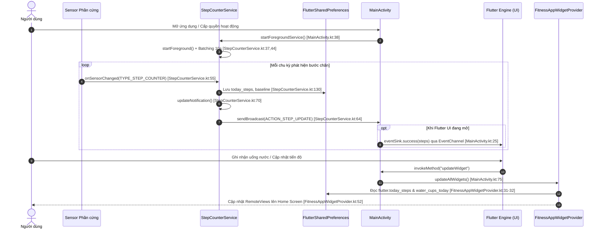

# Phân tích Lớp Native Android (W1)

## 1. Tóm tắt
Lớp Native Android của dự án Fitness Tracker gồm ~400 dòng mã nguồn Kotlin kết hợp hệ thống tài nguyên XML và cấu hình Gradle hiện đại (AGP 8.11, Kotlin 2.2, compileSdk 34, minSdk 26). Thành phần này đảm nhiệm trực tiếp các tác vụ hệ thống cấp thấp: đếm bước chân liên tục qua Foreground Service kết hợp gộp mẫu cảm biến (sensor batching), tự phục hồi dịch vụ sau khi khởi động máy thông qua BroadcastReceiver, cung cấp widget màn hình chính thời gian thực thông qua RemoteViews và SharedPreferences hai chiều, đồng thời thiết lập cầu nối MethodChannel/EventChannel hoàn chỉnh giao tiếp với Flutter Engine.

## 2. Chức năng

| Chức năng | Mô tả ngắn | file:line |
|---|---|---|
| **Đếm bước chạy nền liên tục** | Foreground Service duy trì tiến trình chạy bền bỉ với thông báo thường trực, đọc dữ liệu phần cứng `TYPE_STEP_COUNTER`, tự động tính toán bù trừ bước chân theo ngày và xử lý reset sau khởi động lại máy. | `android/app/src/main/kotlin/com/example/fitness_tracker/StepCounterService.kt:22-134` |
| **Thông báo trạng thái tiến độ** | Hiển thị Notification liên tục trên thanh thông báo với tỷ lệ phần trăm hoàn thành chỉ tiêu 10.000 bước, gắn `PendingIntent` mở lại giao diện chính của ứng dụng khi người dùng nhấn vào. | `android/app/src/main/kotlin/com/example/fitness_tracker/StepCounterService.kt:136-169` |
| **Tự kích hoạt sau khi khởi động máy** | BroadcastReceiver bắt sự kiện `BOOT_COMPLETED`, nâng cấp gói hoặc khởi động nhanh trên các dòng máy chuyên biệt để tự động đánh thức `StepCounterService`. | `android/app/src/main/kotlin/com/example/fitness_tracker/BootReceiver.kt:8-25` |
| **Widget màn hình chính (App Widget)** | Cung cấp widget 4x2 trên màn hình chính Android hiển thị song song chỉ số bước chân và số cốc nước theo phong cách neon dark theme, định kỳ cập nhật 30 phút hoặc cập nhật tức thời khi Flutter kích hoạt. | `android/app/src/main/kotlin/com/example/fitness_tracker/FitnessAppWidgetProvider.kt:12-66`, `android/app/src/main/res/xml/fitness_app_widget_info.xml:1-11`, `android/app/src/main/res/layout/fitness_app_widget.xml:2-118` |
| **Quản lý dịch vụ & Ngoại lệ tối ưu pin** | Tiếp nhận tín hiệu từ Flutter để khởi động Foreground Service, kiểm tra và hiển thị hộp thoại yêu cầu người dùng loại trừ ứng dụng khỏi danh sách tối ưu hóa pin của hệ thống (Doze mode). | `android/app/src/main/kotlin/com/example/fitness_tracker/MainActivity.kt:33-80` |
| **Phát luồng dữ liệu bước chân thời gian thực** | Đăng ký Dynamic BroadcastReceiver bên trong Activity để lắng nghe sự kiện bước chân phát từ Service, sau đó truyền luồng sự kiện tới Flutter UI thông qua EventChannel StreamHandler. | `android/app/src/main/kotlin/com/example/fitness_tracker/MainActivity.kt:17-28,82-102` |
| **Cấu hình giao diện khởi động (Splash Theme)** | Định nghĩa theme cửa sổ khởi động hỗ trợ cả chế độ sáng (Light) và tối (Dark), hiển thị hình nền tạm thời trong lúc chờ Flutter Engine tải khung hình đầu tiên. | `android/app/src/main/res/values/styles.xml:4-17`, `android/app/src/main/res/values-night/styles.xml:4-17` |

## 3. Kỹ thuật Android/Flutter

| Kỹ thuật / API | Cách dùng trong dự án | file:line | API level / Quyền liên quan |
|---|---|---|---|
| **Foreground Service (`health`)** | Khởi chạy dịch vụ tiền đình `StepCounterService` với loại `foregroundServiceType="health"` và `startForeground()`, đảm bảo tiến trình không bị hệ điều hành tiêu diệt. | `StepCounterService.kt:37`, `AndroidManifest.xml:4-5,56-59` | API 26+ (`startForeground`), API 34+ (`FOREGROUND_SERVICE_HEALTH`), `android.permission.FOREGROUND_SERVICE` |
| **`SensorManager` & Sensor Batching** | Lắng nghe cảm biến phần cứng `Sensor.TYPE_STEP_COUNTER` với tham số `maxReportLatency = 10_000_000` micro giây (gộp dữ liệu 10 giây một lần) nhằm giảm thiểu số lần đánh thức CPU. | `StepCounterService.kt:39-48` | API 19+ (KitKat), quyền `android.permission.ACTIVITY_RECOGNITION` (API 29+) |
| **`NotificationChannel` & `NotificationCompat`** | Khởi tạo Notification Channel `StepCounterChannel` mức độ quan trọng `IMPORTANCE_LOW` không rung, xây dựng thông báo `setOngoing(true)` và `setOnlyAlertOnce(true)`. | `StepCounterService.kt:155-164,181-193` | API 26+ (Notification Channel), quyền `android.permission.POST_NOTIFICATIONS` (API 33+) |
| **Tĩnh BroadcastReceiver (`BootReceiver`)** | Đăng ký tĩnh trong Manifest các action `ACTION_BOOT_COMPLETED`, `ACTION_MY_PACKAGE_REPLACED`, và `QUICKBOOT_POWERON` để tự động kích hoạt `startForegroundService()`. | `BootReceiver.kt:12-24`, `AndroidManifest.xml:71-81` | Quyền `android.permission.RECEIVE_BOOT_COMPLETED` |
| **Động BroadcastReceiver an toàn API 33+** | Đăng ký `stepReceiver` nội bộ bên trong Activity, tự động phân nhánh sử dụng cờ `Context.RECEIVER_NOT_EXPORTED` trên Android 13+ để phòng chống tấn công chèn Intent giả mạo. | `MainActivity.kt:86-91` | API 33+ (`Context.RECEIVER_NOT_EXPORTED`) |
| **`AppWidgetProvider` & `RemoteViews`** | Kế thừa `AppWidgetProvider`, sử dụng `RemoteViews` liên kết layout XML `fitness_app_widget` để cập nhật giao diện widget từ tiến trình khác mà không cần hiển thị Activity. | `FitnessAppWidgetProvider.kt:12-53`, `fitness_app_widget.xml:2-118` | API 26+, `android.appwidget.action.APPWIDGET_UPDATE` |
| **Chia sẻ SharedPreferences hai chiều** | Native code đọc/ghi trực tiếp tệp cấu hình `"FlutterSharedPreferences"` (với tiền tố khóa `flutter.*`) để trao đổi dữ liệu số bước và lượng nước với Flutter Engine khi Flutter chưa chạy. | `StepCounterService.kt:74-76,108-114,129-132`, `FitnessAppWidgetProvider.kt:30-33` | Cơ chế SharedPreferences nguyên bản của Android |
| **MethodChannel (`.../service`)** | Cầu nối lệnh tiếp nhận các phương thức gọi từ Dart: `startService`, `isIgnoringBatteryOptimizations`, `requestIgnoreBatteryOptimizations`, `updateWidget`. | `MainActivity.kt:18,33-80` | Flutter BinaryMessenger |
| **EventChannel (`.../steps`)** | Cầu nối luồng sự kiện gắn với `EventChannel.StreamHandler`, quản lý vòng đời `onListen`/`onCancel` và đẩy dữ liệu số bước qua `eventSink.success()`. | `MainActivity.kt:17,82-102` | Flutter BinaryMessenger |
| **Bỏ tối ưu hóa pin (Doze Mode Exemption)** | Kiểm tra `PowerManager.isIgnoringBatteryOptimizations()` và khởi động Intent `Settings.ACTION_REQUEST_IGNORE_BATTERY_OPTIMIZATIONS` với định danh gói app. | `MainActivity.kt:44-73`, `AndroidManifest.xml:14` | API 23+, quyền `android.permission.REQUEST_IGNORE_BATTERY_OPTIMIZATIONS` |
| **Khai báo Package Visibility (`<queries>`)** | Khai báo trong Manifest quyền nhìn thấy gói ứng dụng Health Connect (`com.google.android.apps.healthdata`) và dịch vụ nhận dạng giọng nói (`RecognitionService`). | `AndroidManifest.xml:99-111` | API 30+ (Android 11) |
| **Desugaring & Biên dịch Java 17** | Cấu hình `isCoreLibraryDesugaringEnabled = true` đi kèm thư viện `desugar_jdk_libs:2.1.4`, cho phép sử dụng các API Java hiện đại trên thiết bị chạy Android 8.0 (minSdk 26). | `android/app/build.gradle.kts:14-22,44` | Gradle Plugin / Java 17 |

## 4. Luồng xử lý chính

Sơ đồ tuần tự sau đây mô tả toàn bộ vòng đời tương tác giữa cảm biến phần cứng, dịch vụ nền Android, bộ nhớ SharedPreferences, giao diện Flutter và App Widget:



### Chi tiết các giai đoạn thực thi:
1. **Khởi tạo và gộp mẫu cảm biến**: Khi `StepCounterService` khởi chạy, nó gọi ngay `startForeground()` (`StepCounterService.kt:37`) với ID cố định và đăng ký `Sensor.TYPE_STEP_COUNTER` với chu kỳ trễ 10.000.000 micro giây (`StepCounterService.kt:44`). Cảm biến phần cứng sẽ tích lũy các bước chân và chỉ đánh thức CPU sau mỗi 10 giây để tiết kiệm pin.
2. **Tính toán mốc cơ sở (Baseline Algorithm)**: Do cảm biến phần cứng trả về tổng số bước tích lũy từ lúc bật máy, hàm `processNativeHardwareSteps` (`StepCounterService.kt:95-134`) thực hiện:
   - Lưu `step_baseline_hardware` và ngày hiện tại `step_baseline_date`.
   - Nếu sang ngày mới hoặc chưa có mốc: đặt baseline bằng giá trị phần cứng hiện tại và reset số bước hôm nay về 0.
   - Nếu thiết bị vừa khởi động lại (giá trị phần cứng nhỏ hơn baseline cũ): cộng dồn số bước trước khi tắt máy vào `step_reboot_offset`.
3. **Phân phối đa đích**: Kết quả số bước được ghi đồng thời vào 3 nơi: tệp XML `FlutterSharedPreferences` (`StepCounterService.kt:130`), thông báo Notification qua `NotificationManager.notify()` (`StepCounterService.kt:168`), và phát Broadcast Intent nội bộ để MainActivity chuyển tiếp vào `EventSink` của Flutter (`MainActivity.kt:25`).

## 5. Hạn chế & rủi ro

- **Nguy cơ tranh chấp dữ liệu (Race Condition) trên SharedPreferences**: Cả tầng Native Kotlin (`StepCounterService.kt:130-131`) lẫn tầng Dart (thông qua package `shared_preferences`) cùng đọc và ghi không đồng bộ (`apply()`) vào cùng tệp `"FlutterSharedPreferences"`. Do không có cơ chế khóa liên tiến trình (inter-process locking), nếu người dùng vừa tương tác trên giao diện vừa đi bộ nhanh, nguy cơ ghi đè làm mất dữ liệu bước chân có thể xảy ra.
- **Kích hoạt ngầm thiếu điều kiện sau Boot**: `BootReceiver.kt:18-23` tự động gọi `startForegroundService` ngay khi nhận được tín hiệu `BOOT_COMPLETED` mà không kiểm tra xem người dùng có từng bật tính năng theo dõi bước chân trong cấu hình ứng dụng hay không.
- **Rủi ro bảo mật trong cấu hình ký bản phát hành (Release Signing)**: Trong `android/app/build.gradle.kts:35-39`, cấu hình bản `release` đang tái sử dụng trực tiếp chứng chỉ gỡ lỗi: `signingConfig = signingConfigs.getByName("debug")`. Nếu đưa mã nguồn này ra môi trường sản xuất mà không thay bằng keystore chính thức, ứng dụng sẽ đối mặt với nguy cơ bị giả mạo chữ ký số.
- **Bất nhất định danh gói (`namespace` vs `applicationId`)**: Định danh mã nguồn Kotlin được đặt là `namespace = "com.example.fitness_tracker"` (`android/app/build.gradle.kts:10`), nhưng định danh xuất bản lại là `applicationId = "com.nhh031.fitness_tracker"` (`android/app/build.gradle.kts:25`). Sự sai lệch này có thể gây lỗi cấu hình khi tích hợp các dịch vụ bên thứ ba đòi hỏi package name trùng khớp (như Google API Console hoặc Health Connect).
- **Viết cứng mục tiêu và chuỗi văn bản trên Widget**:
  - Chỉ tiêu 10.000 bước được gán cứng trong mã nguồn Kotlin (`StepCounterService.kt:147`, `FitnessAppWidgetProvider.kt:38`) và layout XML (`fitness_app_widget.xml:69`), hoàn toàn không liên kết với mục tiêu cá nhân mà người dùng thiết lập trong Profile trên Flutter.
  - Chỉ tiêu nước 8 cốc bị viết cứng tại `FitnessAppWidgetProvider.kt:39` và `fitness_app_widget.xml:101`.
  - Các nhãn hiển thị trên widget như `"⚡ FITNESS TRACKER"`, `"👟 Bước chân"`, `"💧 Nước uống"` được gán trực tiếp trong XML thay vì đặt trong `strings.xml`, làm mất khả năng bản địa hóa (đa ngôn ngữ).
- **Bắt ngoại lệ âm thầm (Empty Catch Block)**: Phương thức `updateAllWidgets` bắt lỗi bằng khối `catch (e: Exception) {}` hoàn toàn rỗng (`FitnessAppWidgetProvider.kt:63-65`), tương tự tại `MainActivity.kt:98,108`. Việc nuốt ngoại lệ này khiến lập trình viên không thể phát hiện lỗi khi `AppWidgetManager` thất bại trong việc cập nhật giao diện.
- **Thiếu bộ lọc nhiễu bước chân (Anti-jitter Filter)**: `StepCounterService.kt:55-72` tiếp nhận trực tiếp mọi tín hiệu từ `TYPE_STEP_COUNTER` mà không kiểm tra vận tốc hoặc loại bỏ nhiễu rung lắc cơ học bất thường (false positives khi đi xe máy, rung lắc thiết bị).
- **Thiếu hoàn toàn kiểm thử tự động (Unit Test / Instrumented Test)**: Toàn bộ thư mục `android/app/src/test` và `android/app/src/androidTest` không có bất kỳ test case nào để kiểm tra vòng đời của `StepCounterService`, độ chính xác của thuật toán baseline hay tính đúng đắn của `BootReceiver`.

## 6. Gợi ý cho báo cáo

### Các mục báo cáo đề xuất (Ánh xạ theo đề cương môn học):
1. **Chương "Các thành phần ứng dụng Android cốt lõi" (Android Application Components)**:
   - Trình bày chi tiết cơ chế hoạt động của **Foreground Service** đi kèm loại dịch vụ `health` theo chuẩn Android 14+ (`StepCounterService.kt:37,58`).
   - Phân tích cơ chế bắt sự kiện hệ thống của **BroadcastReceiver** tĩnh (`BootReceiver.kt:8-25`) và động với cờ bảo mật `RECEIVER_NOT_EXPORTED` (`MainActivity.kt:87-91`).
   - Phân tích kiến trúc **AppWidgetProvider** và cơ chế vẽ giao diện từ xa thông qua **RemoteViews** (`FitnessAppWidgetProvider.kt:37-52`).
2. **Chương "Giao tiếp giữa Flutter Engine và Nền tảng Native"**:
   - So sánh hai mô hình: **MethodChannel** (gọi hàm một lần có phản hồi - `MainActivity.kt:33-80`) và **EventChannel** (luồng dữ liệu liên tục - `MainActivity.kt:82-102`).
   - Phân tích giải pháp chia sẻ bộ nhớ dùng chung không phụ thuộc Flutter Runtime thông qua `FlutterSharedPreferences`.
3. **Chương "Tối ưu hóa hiệu năng, Quản lý năng lượng và Quyền riêng tư"**:
   - Kỹ thuật gộp mẫu cảm biến (Sensor Batching 10s) nhằm giảm số lần CPU Wakeup.
   - Cơ chế vượt rào Doze Mode thông qua quyền `REQUEST_IGNORE_BATTERY_OPTIMIZATIONS` (`MainActivity.kt:53-73`).
   - Hệ thống quyền bảo mật runtime: `ACTIVITY_RECOGNITION`, `POST_NOTIFICATIONS`, và tích hợp Health Connect qua `<queries>`.

### Danh mục câu lệnh ADB cần thực thi làm minh chứng:
```bash
# 1. Kiểm tra trạng thái Foreground Service đang chạy ngầm trong hệ thống
adb shell dumpsys activity services com.nhh031.fitness_tracker

# 2. Kiểm tra thông tin đăng ký và trạng thái App Widget trên màn hình chính
adb shell dumpsys appwidget | findstr fitness

# 3. Kiểm tra trạng thái ứng dụng trong danh sách trắng miễn trừ tiết kiệm pin
adb shell dumpsys deviceidle whitelist | findstr fitness

# 4. Kiểm tra danh sách quyền runtime và trạng thái AppOps (cảm biến, thông báo)
adb shell cmd appops get com.nhh031.fitness_tracker

# 5. Giả lập phát broadcast BOOT_COMPLETED để kiểm tra tự kích hoạt dịch vụ
adb shell am broadcast -a android.intent.action.BOOT_COMPLETED -p com.nhh031.fitness_tracker

# 6. Theo dõi luồng logcat từ cảm biến native và kênh truyền Flutter
adb logcat -s StepCounterService:V MainActivity:V flutter:V
```

### Danh mục ảnh chụp màn hình cần chuẩn bị:
1. **Ảnh thông báo trạng thái Foreground Service**: Chụp thanh thông báo hệ thống hiển thị Ongoing Notification với biểu tượng bước chân, số bước hiện tại và tiến độ phần trăm (`StepCounterService.kt:150`).
2. **Ảnh Widget trên Launcher**: Chụp màn hình Home Screen chứa Widget 4x2 hiển thị số bước chân và số cốc nước trên nền viền xanh neon (`fitness_app_widget.xml:21,65,97`).
3. **Ảnh hộp thoại xin quyền miễn trừ pin**: Hộp thoại hệ thống yêu cầu "Bỏ qua tối ưu hóa pin" khi ứng dụng kích hoạt `ACTION_REQUEST_IGNORE_BATTERY_OPTIMIZATIONS` (`MainActivity.kt:56`).
4. **Ảnh cài đặt quyền ứng dụng (App Info Settings)**: Màn hình Cài đặt của Android thể hiện các quyền đã được cấp: "Hoạt động thể chất", "Thông báo", "Bộ nhớ".
5. **Ảnh hộp thoại phân quyền Health Connect**: Màn hình xin quyền đọc dữ liệu sức khỏe từ Health Connect (`ACTION_SHOW_PERMISSIONS_RATIONALE` - `AndroidManifest.xml:47,102`).
