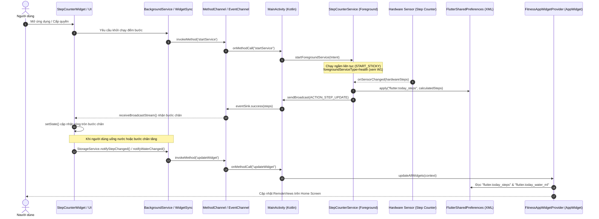

# Phân tích Cầu nối Flutter ↔ Android & Plugin Hệ thống (W2)

## 1. Tóm tắt
Tầng cầu nối Flutter ↔ Android trong Fitness Tracker kết nối giao diện Dart với dịch vụ phần cứng và hệ thống nền tảng Android. Kiến trúc phối hợp `MethodChannel` 2 chiều (điều khiển Foreground Service, tối ưu pin, cập nhật Home Widget) và `EventChannel` 1 chiều (truyền stream bước chân thời gian thực từ cảm biến phần cứng qua BroadcastReceiver). Dữ liệu đếm bước được chia sẻ 2 chiều qua `FlutterSharedPreferences`. Bên cạnh đó, ứng dụng tích hợp hệ sinh thái plugin chuẩn gồm `local_auth` (BiometricPrompt), `health` (Health Connect), `flutter_local_notifications` (nhắc nước & đồng hồ đếm ngược nghỉ hiệp), `speech_to_text` (ghi chép dinh dưỡng bằng giọng nói) và `mobile_scanner` (quét mã vạch thực phẩm qua camera).

---

## 2. Chức năng

| Chức năng | Mô tả ngắn | Dẫn chứng `file:line` |
|---|---|---|
| Khởi chạy StepCounterService | Gọi MethodChannel kích hoạt Foreground Service native để đếm bước liên tục dưới nền ngay cả khi tắt UI | `lib/services/background_service.dart:8-12`, `lib/widgets/step_counter_widget.dart:89` (native: xem W1 `MainActivity.kt:35-43`) |
| Kiểm tra miễn trừ tối ưu pin | Gọi MethodChannel kiểm tra ứng dụng đã được đưa vào danh sách trắng Doze mode chưa | `lib/services/background_service.dart:15-23`, `lib/screens/profile_screen.dart:65,76-83` (native: xem W1 `MainActivity.kt:44-52`) |
| Yêu cầu bỏ qua tối ưu pin | Kích hoạt Intent hệ thống `ACTION_REQUEST_IGNORE_BATTERY_OPTIMIZATIONS` để người dùng cấp quyền chạy ngầm không giới hạn | `lib/services/background_service.dart:26-34`, `lib/screens/profile/profile_battery_card.dart:128-153`, `lib/screens/profile_screen.dart:85-89` (native: xem W1 `MainActivity.kt:53-73`) |
| Cập nhật Home Widget tức thì | Gửi thông điệp MethodChannel yêu cầu Android refresh `RemoteViews` của tiện ích màn hình chính khi bước chân hoặc nước thay đổi | `lib/services/widget_sync_service.dart:8-12`, `lib/services/storage_service.dart:48,54` (native: xem W1 `MainActivity.kt:74-77`) |
| Nhận luồng bước chân phần cứng | Lắng nghe `EventChannel.receiveBroadcastStream()`, nhận số bước chân phần cứng phát ra từ cảm biến native | `lib/widgets/step_counter_widget.dart:29,95-109` (native: xem W1 `MainActivity.kt:82-103`) |
| Xin quyền nhận diện vận động | Yêu cầu quyền runtime `ACTIVITY_RECOGNITION` trước khi khởi động Service và mở luồng cảm biến | `lib/widgets/step_counter_widget.dart:85` |
| Xác thực sinh trắc học | Kiểm tra phần cứng (`canCheckBiometrics`), quét vân tay / Face ID bằng `LocalAuthentication` để bảo vệ ứng dụng | `lib/services/biometric_service.dart:15-24,37-56`, `lib/screens/profile/profile_security_report_card.dart:40-44` |
| Cổng khóa bảo vệ ứng dụng (BiometricGate) | Kiểm tra cấu hình khóa khi khởi động và chặn hiển thị `MainScreen` cho đến khi xác thực thành công | `lib/widgets/biometric_gate.dart:16-59`, `lib/widgets/auth_gate.dart:30` |
| Bật / tắt khóa ứng dụng | Lưu trạng thái cấu hình khóa vào `SharedPreferences` và đồng bộ cấu hình bảo mật lên Cloud Firestore | `lib/services/biometric_service.dart:59-69`, `lib/screens/profile/profile_security_report_card.dart:28,62` |
| Hiển thị nhân trắc học thể chất | Trình bày các chỉ số BMI, BMR, TDEE và dẫn tới phân hệ đo đạc thể chất Before/After | `lib/screens/profile/profile_biometrics_card.dart:8-210`, `lib/screens/profile_screen.dart:443-448` |
| Kết nối Google Health Connect | Khởi tạo cấu hình và yêu cầu cấp quyền đọc 4 nhóm chỉ số sức khỏe từ Google Health Connect trên Android | `lib/services/health_sync_service.dart:124-178`, `lib/screens/profile/profile_health_connect_card.dart:315-320` |
| Đồng bộ dữ liệu Health Connect | Đọc các bản ghi bước chân, nhịp tim, giấc ngủ, calo tiêu hao từ Health Connect và ghi vào `StepRepository` | `lib/services/health_sync_service.dart:205-317`, `lib/screens/profile/profile_health_connect_card.dart:293` |
| Nhắc nhở uống nước định kỳ | Lên lịch thông báo chính xác trong khoảng 08:00–21:00 bằng `zonedSchedule` + `exactAllowWhileIdle` | `lib/services/notification_service.dart:127-159` |
| Đồng hồ nghỉ ngơi trên Notification (v2.0) | Hiển thị thông báo Ongoing kèm thanh tiến trình (`showProgress`) đếm ngược thời gian nghỉ giữa các hiệp tập | `lib/services/notification_service.dart:181-234`, `lib/screens/active_workout_screen.dart:278,289` |
| Báo chuông kết thúc nghỉ hiệp | Bắn thông báo phát âm thanh và rung thông báo người dùng sẵn sàng bước vào hiệp nâng tạ kế tiếp | `lib/services/notification_service.dart:237-266`, `lib/screens/active_workout_screen.dart:301` |
| Nhập thực phẩm bằng giọng nói | Khởi tạo engine `speech_to_text`, nhận diện chuỗi giọng nói trực tiếp để điền tên và số lượng món ăn | `lib/services/speech_service.dart:15-74`, `lib/widgets/ai_food_logging_widget.dart:87,128` |
| Quét mã vạch thực phẩm qua Camera | Mở luồng CameraX nhận diện barcode EAN/UPC thời gian thực, có điều khiển đèn flash và lật camera | `lib/widgets/barcode_scanner_sheet.dart:52-56,267-281,357-375` |

---

## 3. Kỹ thuật Android/Flutter

| Kỹ thuật / API | Cách dùng trong dự án | Dẫn chứng `file:line` | API Level / Quyền liên quan |
|---|---|---|---|
| `MethodChannel` (`invokeMethod`) | Tạo kênh `com.example.fitness_tracker/service` để gọi 4 phương thức native: `startService`, `isIgnoringBatteryOptimizations`, `requestIgnoreBatteryOptimizations`, `updateWidget` | `lib/services/background_service.dart:4-5,10,18,29`, `lib/services/widget_sync_service.dart:4-5,10`, `lib/widgets/step_counter_widget.dart:28,89` | Tất cả API level (nền tảng Flutter Engine) |
| `EventChannel` (`receiveBroadcastStream`) | Tạo kênh `com.example.fitness_tracker/steps` nhận sự kiện số bước nguyên tử (`int`) từ `BroadcastReceiver` của `MainActivity` | `lib/widgets/step_counter_widget.dart:29,96-107` | Tất cả API level (Native xem W1 `MainActivity.kt:82-103`) |
| `PowerManager` & Battery Optimization Intent | Kiểm tra `isIgnoringBatteryOptimizations` và gọi Intent `Settings.ACTION_REQUEST_IGNORE_BATTERY_OPTIMIZATIONS` với URI `package:packageName` | `lib/services/background_service.dart:18,29`, `lib/screens/profile/profile_battery_card.dart:129` | API 23+ (Android 6.0 Marshmallow); Quyền: `android.permission.REQUEST_IGNORE_BATTERY_OPTIMIZATIONS` |
| `SharedPreferences` (Cơ chế chia sẻ 2 chiều) | Cầu nối chia sẻ dữ liệu ngầm không qua RAM: Flutter lưu cache qua `shared_preferences` (tiền tố `flutter.`), Native Android (`StepCounterService` và `FitnessAppWidgetProvider`) đọc/ghi trực tiếp vào file XML `FlutterSharedPreferences` | `lib/repositories/step_repository.dart:12-16,46,57-64,71-99`, `lib/services/health_sync_service.dart:63-69,94-101,297-302`, `lib/services/biometric_service.dart:12,60-67` | API 1+ (`android.content.SharedPreferences`, native xem W1) |
| `BiometricPrompt` (`local_auth`) | Gọi `_auth.authenticate(localizedReason, biometricOnly: false, persistAcrossBackgrounding: true)`. Cho phép fallback về mật khẩu thiết bị nếu không có vân tay | `lib/services/biometric_service.dart:11,17-19,47-51` | API 28+ (Android 9.0 Pie); Quyền: `android.permission.USE_BIOMETRIC` |
| `WidgetsBindingObserver` | Đăng ký observer trong `initState` và hủy trong `dispose`, lắng nghe `AppLifecycleState.resumed` để kích hoạt xác thực sinh trắc | `lib/widgets/biometric_gate.dart:16,23,29,34-38` | Flutter Foundation Lifecycle API |
| Google Health Connect API (`health` plugin) | Cấu hình qua `configure()`, kiểm tra `isHealthConnectAvailable()`, gọi `requestAuthorization` với 4 kiểu dữ liệu: `STEPS`, `HEART_RATE`, `ACTIVE_ENERGY_BURNED`, `SLEEP_SESSION` | `lib/services/health_sync_service.dart:3,79-89,131-150,222,237,255,275` | API 34+ (tích hợp sẵn) hoặc Android 8.0–13 qua ứng dụng Health Connect; Quyền: `android.permission.health.READ_*` |
| Notification Channel & Local Notifications | Khởi tạo 2 kênh thông báo riêng biệt: `water_reminder_channel` (Importance Max) và `rest_timer_channel` (Importance High, `onlyAlertOnce: true`) | `lib/services/notification_service.dart:16-19,72-84,178-202` | API 26+ (Android 8.0 O Notification Channels); Quyền: `android.permission.POST_NOTIFICATIONS` (API 33+) |
| Exact Alarms (`timezone` + `zonedSchedule`) | Lên lịch báo thức chính xác bằng `AndroidScheduleMode.exactAllowWhileIdle` kết hợp `matchDateTimeComponents: DateTimeComponents.time` để vượt chế độ Doze | `lib/services/notification_service.dart:116-124,148-156` | API 31+ (Android 12 S); Quyền: `android.permission.SCHEDULE_EXACT_ALARM` |
| Ongoing Notification với Progress Bar | Tạo thông báo đếm ngược thời gian nghỉ hiệp với các thuộc tính `ongoing: true`, `showProgress: true`, `maxProgress`, `progress` | `lib/services/notification_service.dart:186-202,221-230` | API 1+ (Android NotificationCompat Progress) |
| Speech Recognition (`speech_to_text`) | Bọc Android `RecognitionService`, khởi tạo qua `initialize()`, truy vấn `locales()`, thu âm chuyển văn bản với `ListenMode.dictation` | `lib/services/speech_service.dart:2,9,22,51,63-73` | API 21+; Quyền: `android.permission.RECORD_AUDIO`, `<queries>` chứa `android.speech.RecognitionService` |
| CameraX / Barcode Scanner (`mobile_scanner`) | Khởi tạo `MobileScannerController(detectionSpeed, facing: back)`, bọc SurfaceTexture xem trước và phân tích barcode ML Kit | `lib/widgets/barcode_scanner_sheet.dart:2,35,52-56,269-281,357-375` | API 21+; Quyền: `android.permission.CAMERA` |
| Activity Recognition (`permission_handler`) | Xin quyền runtime `Permission.activityRecognition.request()` trước khi kích hoạt cảm biến bước chân | `lib/widgets/step_counter_widget.dart:7,85` | API 29+ (Android 10 Q); Quyền: `android.permission.ACTIVITY_RECOGNITION` |

---

## 4. Luồng xử lý chính

Sơ đồ tuần tự thể hiện toàn bộ chu trình giao tiếp giữa UI Flutter, Platform Channels, SharedPreferences và hệ sinh thái Native Android:



---

## 5. Hạn chế & rủi ro

- **Nuốt ngoại lệ rỗng (Silent Exception Swallowing)**:
  - Trong `BackgroundService`, tất cả các hàm `startStepCounterService` (`lib/services/background_service.dart:11`), `isIgnoringBatteryOptimizations` (`lib/services/background_service.dart:20-22`), và `requestIgnoreBatteryOptimizations` (`lib/services/background_service.dart:31-33`) đều sử dụng `catch (_) {}` nuốt toàn bộ lỗi. Nếu nền tảng xảy ra lỗi `MissingPluginException` hoặc thiếu quyền trong Manifest, phía UI hoàn toàn không nhận được cảnh báo.
  - Tương tự, `WidgetSyncService.updateHomeWidget` (`lib/services/widget_sync_service.dart:11`), `NotificationService.cancelRestTimerNotification` (`lib/services/notification_service.dart:273`), và khối khởi tạo tại `main.dart:19-22` đều nuốt ngoại lệ mà không in log truy vết lỗi.
- **Không nhất quán Package Name giữa Flutter và Native Gradle**:
  - Tên kênh MethodChannel và EventChannel bị viết cứng với tiền tố `'com.example.fitness_tracker/service'` và `'com.example.fitness_tracker/steps'` (`lib/services/background_service.dart:4-5`, `lib/widgets/step_counter_widget.dart:28-29`), trong khi `applicationId` cấu hình chính thức trong Gradle là `com.nhh031.fitness_tracker`. Sự phân mảnh tiền tố này dễ dẫn tới lỗi khi tái cấu trúc gói ứng dụng native.
- **Lỗ hổng bảo mật không khóa lại khi chuyển ứng dụng ngầm trong `BiometricGate`**:
  - Tại `lib/widgets/biometric_gate.dart:34-38`, hàm `didChangeAppLifecycleState` chỉ kiểm tra `if (state == AppLifecycleState.resumed && _isLocked)`, nhưng không có logic đặt `_isLocked = true` khi app chuyển sang trạng thái `AppLifecycleState.paused` hoặc `AppLifecycleState.inactive`. Do đó, khi người dùng mở khóa thành công một lần, nếu chuyển sang ứng dụng khác rồi quay lại, ứng dụng **không hề tự động khóa lại**.
  - Ngoài ra, tại `lib/services/biometric_service.dart:44`, nếu thiết bị không hỗ trợ phần cứng sinh trắc học, hàm mặc định `return true` (cho phép vượt qua mà không yêu cầu mã PIN dự phòng).
- **Nguy cơ tranh chấp dữ liệu (Race Condition) trên SharedPreferences**:
  - Cả phía Kotlin (`StepCounterService.kt`, xem W1) và phía Flutter (`StepRepository.instance.saveTodaySteps`, `lib/repositories/step_repository.dart:56-64,78-89`) đều cùng ghi vào file `FlutterSharedPreferences.xml`. Vì hai tiến trình/luồng chạy độc lập không có cơ chế khóa đồng bộ (mutex/file lock), các thao tác ghi đồng thời có thể ghi đè làm mất mốc bước chân hoặc gây hiện tượng nhảy lùi số bước.
- **Hủy thông báo bằng vòng lặp cứng (Hard-coded cancellation loop)**:
  - Trong `lib/services/notification_service.dart:163-165`, hàm `cancelWaterReminders` lặp cứng 20 lần (`for (int i = 0; i < 20; i++)`) từ ID `1001` đến `1020`. Nếu thuật toán tính số mốc nhắc nước trong ngày vượt quá 20 mốc, các thông báo vượt ngưỡng sẽ không thể bị hủy.
- **Giả lập kết nối thành công (Mock Bypass) trên môi trường ảo**:
  - Trong `lib/services/health_sync_service.dart:170-178`, khi kiểm tra không phải thiết bị di động thực tế (`!kIsWeb && ...`), service tự động gán `_status = HealthSyncStatus.connected` và ghi `health_sync_connected = true` vào bộ nhớ. Điều này che giấu thực tế rằng Health Connect chưa từng được cấu hình hay cấp quyền.
- **Rò rỉ tài nguyên StreamSubscription**:
  - Mặc dù `StepCounterWidget` (`lib/widgets/step_counter_widget.dart:60`) có gọi `_stepSubscription?.cancel()`, việc quản lý vòng đời camera trong `BarcodeScannerSheet` (`lib/widgets/barcode_scanner_sheet.dart:70`) cần đảm bảo giải phóng hoàn toàn controller khi đóng bottom sheet để tránh xung đột phần cứng camera với các màn hình khác.

---

## 6. Gợi ý cho báo cáo

### Các mục báo cáo đồ án đề xuất
1. **Chương 4: Kiến trúc giao tiếp nền tảng (Flutter ↔ Android Platform Bridge)**:
   - Cơ chế hoạt động của `MethodChannel` và `EventChannel` qua `BinaryMessenger`.
   - Bảng đối chiếu các Method calls giữa Flutter (`BackgroundService`, `WidgetSyncService`) và Android Native (`MainActivity.kt`).
   - Kỹ thuật chia sẻ dữ liệu hai chiều bằng file XML `FlutterSharedPreferences`.
2. **Chương 5: Quản lý tác vụ ngầm & Tối ưu hóa năng lượng (Background & Power Management)**:
   - Vòng đời của Android Foreground Service và phân loại `foregroundServiceType="health"`.
   - Cơ chế Doze Mode và kỹ thuật yêu cầu quyền `ACTION_REQUEST_IGNORE_BATTERY_OPTIMIZATIONS`.
3. **Chương 6: Tích hợp phần cứng và Dịch vụ hệ thống (Hardware & System Services)**:
   - Bảo mật ứng dụng với `BiometricPrompt` và xử lý vòng đời ứng dụng bằng `WidgetsBindingObserver`.
   - Khai thác Google Health Connect API trên Android 14+.
   - Lập lịch thông báo chính xác với `AlarmManager` (`SCHEDULE_EXACT_ALARM`) và Live Notification với Progress Bar.
   - Nhận diện giọng nói qua `SpeechRecognizer` và camera scanning qua CameraX ML Kit.
4. **Chương 9: Đánh giá hạn chế kỹ thuật & Hướng phát triển**:
   - Phân tích rủi ro Race Condition trên file cấu hình dùng chung và đề xuất giải pháp ContentProvider / Room Database tập trung.
   - Khắc phục lỗ hổng re-lock trong `BiometricGate`.

### Bằng chứng lệnh ADB cần thu thập
```bash
# 1. Kiểm tra trạng thái ứng dụng trong whitelist miễn trừ tối ưu hóa pin (Doze mode)
adb shell dumpsys deviceidle whitelist | findstr com.nhh031.fitness_tracker

# 2. Kiểm tra các quyền runtime và AppOps đã được cấp (Activity Recognition, Exact Alarm)
adb shell cmd appops get com.nhh031.fitness_tracker

# 3. Liệt kê các kênh thông báo (Notification Channels) đã đăng ký trong hệ thống
adb shell dumpsys notification --noredact | findstr -i water_reminder_channel
adb shell dumpsys notification --noredact | findstr -i rest_timer_channel

# 4. Kiểm tra trạng thái đăng ký của Home Widget trên hệ thống
adb shell dumpsys appwidget | findstr com.nhh031.fitness_tracker

# 5. Xem log thời gian thực về giao tiếp Channel và Foreground Service
adb logcat -s flutter StepCounterService MainActivity
```

### Ảnh chụp màn hình cần chuẩn bị
- **Ảnh 1**: Thẻ tối ưu hóa pin (`ProfileBatteryCard`) trên màn hình Profile khi chưa cấp quyền (màu cam) và sau khi đã cấp quyền (màu xanh neon).
- **Ảnh 2**: Hộp thoại hệ thống Android hiển thị yêu cầu "Cho phép ứng dụng luôn chạy ngầm / Bỏ qua tối ưu hóa pin".
- **Ảnh 3**: Thẻ kết nối Google Health Connect (`ProfileHealthConnectCard`) và hộp thoại cấp quyền truy cập 4 chỉ số sức khỏe của Android.
- **Ảnh 4**: Màn hình khóa sinh trắc học (`BiometricGate`) và hộp thoại `BiometricPrompt` quét vân tay / khuôn mặt.
- **Ảnh 5**: Thanh thông báo hệ thống hiển thị cùng lúc: Notification Foreground Service đếm bước, Notification nhắc uống nước, và Notification Ongoing có thanh tiến trình đếm ngược thời gian nghỉ hiệp.
- **Ảnh 6**: Modal bottom sheet quét mã vạch thực phẩm (`BarcodeScannerSheet`) với khung viewfinder và tia laser quét camera trực tiếp.
