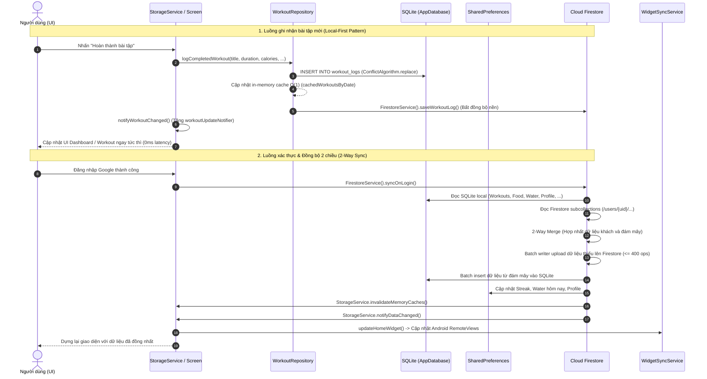

# Phân tích Dữ liệu & Kiến trúc Ứng dụng (W3)

## 1. Tóm tắt
Hệ thống dữ liệu của Fitness Tracker được thiết kế theo mô hình **Local-First kết hợp Cloud Sync 2 chiều (2-Way Synchronization)**. Toàn bộ hoạt động rèn luyện, dinh dưỡng, nước uống và chỉ số sức khỏe được lưu cục bộ trên SQLite (`sqflite`) và `SharedPreferences`, đồng thời đồng bộ tức thời với Cloud Firestore khi có mạng. Tầng trạng thái không dùng thư viện ngoài mà ứng dụng kiến trúc phản ứng nhẹ (Reactive State) dựa trên các `ValueNotifier` phân vùng domain, kết hợp in-memory cache $O(1)$ giảm thiểu tối đa I/O đĩa.

## 2. Chức năng

| Chức năng | Mô tả ngắn | file:line |
|---|---|---|
| Khởi tạo CSDL SQLite cục bộ | Quản lý kết nối Singleton, hỗ trợ SQLite FFI trên Desktop/Test in-memory, khởi tạo 7 bảng dữ liệu và đánh chỉ mục (Index) theo ngày | `lib/database/app_database.dart:10-76` |
| Di trú dữ liệu (Data Migration) | Tự động đọc dữ liệu cũ từ `SharedPreferences` và dùng `batch.insert()` chuyển đổi sang SQLite ở lần chạy đầu tiên qua cờ `sqlite_migrated_v1` | `lib/database/app_database.dart:138-244` |
| Quản lý & Lọc nhiễu Bước chân | Tính toán bước từ cảm biến phần cứng, chống giật/rung xe (Anti-jitter rate limiter $\le 5$ bước/giây), xử lý lệch khi reboot máy và debounce ghi đĩa | `lib/repositories/step_repository.dart:68-134` |
| Ghi nhận & Lưu trữ Nước uống | Quản lý lượng nước tiêu thụ trong ngày, tự động chốt sổ lúc nửa đêm (Midnight rollover), lưu SQLite và đồng bộ Firestore | `lib/repositories/water_repository.dart:39-118` |
| Quản lý Lịch sử Bài tập | Ghi nhận bài tập, thời gian, calo, set/rep/tạ vào bảng `workout_logs`, index theo ngày và timestamp, duy trì RAM cache $O(1)$ | `lib/repositories/workout_repository.dart:27-70` |
| Quản lý Thực phẩm & Dinh dưỡng | Lưu trữ thực phẩm nạp vào bảng `food_entries`, tính tổng Macros (Protein/Carb/Fat/Calo), quản lý món ăn yêu thích (`favorite_foods`) | `lib/repositories/nutrition_repository.dart:29-50, 197-257` |
| Lưu trữ Hội thoại AI Coach | Quản lý lịch sử chat với chuyên gia AI vào bảng `chat_messages`, đồng bộ 2 chiều giữa SQLite cục bộ và Cloud Firestore | `lib/repositories/chat_repository.dart:15-57, 93-104` |
| Theo dõi Chỉ số Nhân trắc học | Lưu trữ số đo các vòng cơ thể, cân nặng và tỷ lệ mỡ (`body_measurements`), xếp theo ngày đo mới nhất | `lib/repositories/body_measurement_repository.dart:11-44` |
| Hồ sơ & Tính toán Trao đổi chất | Tính chỉ số BMI, BMR (Mifflin-St Jeor), TDEE, mục tiêu Calo và phân bổ Macro động theo mục tiêu (Cutting, Bulking, Balanced, Endurance) | `lib/models/user_profile.dart:43-139` |
| Tính toán Chuỗi Hoạt động (Streak) | Quét lịch sử bước chân, calo, nước uống và bài tập để tính số ngày hoạt động liên tục, cập nhật Firestore | `lib/repositories/auth_repository.dart:143-261` |
| Xác thực & Điều hướng (Auth Gate) | Lắng nghe luồng trạng thái đăng nhập Firebase (`StreamBuilder`), kiểm tra `isGuestMode` và onboarding để định tuyến màn hình | `lib/widgets/auth_gate.dart:14-81` |
| Đăng nhập Google & Hợp nhất Dữ liệu | Xác thực Google Sign-In lấy ID Token, liên kết Firebase Auth Credential và kích hoạt quy trình đồng bộ 2 chiều | `lib/services/auth_service.dart:35-60` |
| Đồng bộ Đám mây 2 chiều (2-Way Sync) | Hợp nhất 10 miền dữ liệu giữa máy cục bộ và Firestore khi đăng nhập, chia nhỏ batch writer ($\le 400$ ops) chống vượt ngưỡng Firestore | `lib/services/firestore_service.dart:426-796` |
| Phát tín hiệu Trạng thái Phân vùng | Sử dụng 7 `ValueNotifier` theo từng domain (step, water, food, workout, profile, chat, data) để kích hoạt UI vẽ lại cục bộ | `lib/services/storage_service.dart:31-75` |
| Đồng bộ Widget Màn hình chính | Gọi `WidgetSyncService.updateHomeWidget()` mỗi khi số bước hoặc lượng nước thay đổi để cập nhật AppWidget Android | `lib/services/storage_service.dart:48, 54` |
| Dọn dẹp dữ liệu khi Đăng xuất | Thực thi Transaction xóa toàn bộ 7 bảng SQLite, dọn dẹp các key SharedPreferences và làm sạch in-memory cache | `lib/repositories/auth_repository.dart:264-283` |

## 3. Kỹ thuật Android/Flutter

| Kỹ thuật / API | Cách dùng trong dự án | file:line | API level / Quyền liên quan |
|---|---|---|---|
| `sqflite` (SQLite Engine) | Mở file CSDL `fitness_tracker.db` tại thư mục app data, thực thi DDL tạo 7 bảng, đánh chỉ mục B-tree (`CREATE INDEX`) theo cột `date`, `timestamp` | `lib/database/app_database.dart:57-135, 247-296` | Nền tảng Android (API 1+), Không cần quyền runtime |
| `sqflite_common_ffi` | Khởi tạo engine SQLite native độc lập qua FFI (`sqfliteFfiInit()`, `inMemoryDatabasePath`) phục vụ Desktop và Unit Test không phụ thuộc thiết bị Android thật | `lib/database/app_database.dart:18-29, 48-55` | Hỗ trợ Windows/Linux/macOS & Unit Test CI |
| SQLite Batch & Transaction | Thực hiện di chuyển dữ liệu lớn (`db.batch()`) và xóa an toàn đa bảng khi đăng xuất (`db.transaction()`) đảm bảo tính toàn vẹn ACID | `lib/database/app_database.dart:146-239, 301-309` | Chuẩn SQLite transaction |
| `SharedPreferences` (`FlutterSharedPreferences`) | Lưu cấu hình ứng dụng, bộ đệm đồng bộ widget native (`today_steps`, `water_cups_today`), chia sẻ trạng thái với service nền Android | `lib/repositories/step_repository.dart:46-64`, `lib/repositories/water_repository.dart:40-84` | Lưu tại XML `/data/data/.../shared_prefs/FlutterSharedPreferences.xml` |
| In-Memory Cache Pattern | Lưu trữ bản đồ ngày `Map<String, List<T>>` trên RAM cho thực phẩm, bài tập, bước chân; giảm tải truy vấn đĩa $O(1)$ khi chuyển ngày | `lib/repositories/workout_repository.dart:12, 61-66, 96-111`, `lib/repositories/nutrition_repository.dart:14, 40-45` | Tối ưu hóa bộ nhớ heap Dart |
| Debounced Disk I/O | Hạn chế số lần ghi vào đĩa của bộ đếm bước chân: chỉ ghi xuống `SharedPreferences` khi số bước thay đổi $\ge 3$ hoặc sau $\ge 2$ giây | `lib/repositories/step_repository.dart:121-132` | Giảm hao mòn flash storage & tiết kiệm pin CPU |
| `cloud_firestore` (Cloud NoSQL) | Lưu trữ phân cấp `/users/{uid}/{sub_collections}`, thực hiện đồng bộ đám mây với `FieldValue.serverTimestamp()` và `SetOptions(merge: true)` | `lib/services/firestore_service.dart:34-50, 94, 133` | Yêu cầu `android.permission.INTERNET` |
| Firestore WriteBatch Chunking | Gom nhóm các tác vụ ghi/sửa dữ liệu đám mây vào `WriteBatch`, ngắt và commit định kỳ tại mốc 400 operations tránh vượt giới hạn 500 của Firestore | `lib/services/firestore_service.dart:500-509, 777-779` | Quản lý hạn ngạch mạng & giới hạn Firestore SDK |
| `firebase_auth` & `google_sign_in` | Xác thực người dùng bằng OAuth Credential (ID Token) của Google, lắng nghe phiên qua `authStateChanges` Stream | `lib/services/auth_service.dart:35-60`, `lib/widgets/auth_gate.dart:40-80` | Yêu cầu `INTERNET`, cấu hình SHA-1 Firebase Console |
| Scoped `ValueNotifier<int>` | Cơ chế Reactive State Management gốc của Flutter; mỗi domain nghiệp vụ sở hữu một notifier riêng biệt, tránh rebuild toàn bộ cây widget | `lib/services/storage_service.dart:31-75`, `lib/screens/main_screen.dart:18-29` | Flutter Foundation framework (Không tốn chi phí thư viện ngoài) |
| `IndexedStack` Navigation State | Giữ nguyên trạng thái cây phần tử (Element Tree) và State của 4 màn hình chính (`Dashboard`, `Workout`, `Food`, `Profile`) khi chuyển tab | `lib/screens/main_screen.dart:83-98` | Tối ưu hóa hiệu năng render Flutter |
| `KeyedSubtree` Session Invalidation | Gán `UniqueKey` vào `IndexedStack` hoặc `KeyedSubtree(key: ValueKey(sessionKey))` để hủy và dựng lại toàn bộ giao diện khi đổi tài khoản | `lib/screens/main_screen.dart:37, 59-65, 95`, `lib/widgets/auth_gate.dart:15-16` | Quản lý vòng đời Widget của Flutter |

## 4. Luồng xử lý chính

Sơ đồ tuần tự thể hiện kiến trúc **Local-First kết hợp Cloud Sync 2 chiều** khi người dùng ghi nhận dữ liệu mới (ví dụ bài tập hoàn thành) và khi đăng nhập Google để hợp nhất dữ liệu:



## 5. Hạn chế & rủi ro

- **Hiện tượng "God Facade" và trùng lặp mã nguồn nghiêm trọng trong `StorageService`**: `StorageService` có quy mô lên đến 2.271 dòng code (`lib/services/storage_service.dart:1-2271`). Lớp này ôm đồm toàn bộ nghiệp vụ từ bước chân, nước uống, streak, calo đến Gemini API key. Đáng chú ý, thuật toán đếm bước phần cứng kết hợp anti-jitter tại `lib/services/storage_service.dart:197-263` bị sao chép nguyên văn từ `lib/repositories/step_repository.dart:68-134`, gây phân mảnh logic và khó khăn khi bảo trì.
- **Trùng lặp lời gọi mạng đẩy dữ liệu lên Firestore (Dual Network Push)**: Khi ghi nhận bài tập qua `StorageService.logCompletedWorkout`, hệ thống gọi `FirestoreService().saveWorkoutLog()` tại `lib/services/storage_service.dart:1087`, sau đó lại gọi `WorkoutRepository.instance.logCompletedWorkout()` (`lib/services/storage_service.dart:1089`) – bên trong repository này lại gọi tiếp `FirestoreService().saveWorkoutLog()` một lần nữa (`lib/repositories/workout_repository.dart:69`). Hiện tượng dual push tương tự cũng xảy ra đối với món ăn (`lib/services/storage_service.dart:1396, 1398` và `lib/repositories/nutrition_repository.dart:48`).
- **Nuốt lỗi khởi tạo CSDL và dịch vụ nền trong hàm `main()`**: Trong `lib/main.dart:19-22`, khối lệnh khởi tạo `AppDatabase.instance.database` và `HealthSyncService.instance.init()` được bọc trong `try { ... } catch (_) {}` hoàn toàn rỗng. Nếu file SQLite bị hỏng (corrupted) hoặc quyền truy cập bộ nhớ lỗi, ứng dụng sẽ âm thầm tiếp tục chạy mà không báo lỗi, dẫn đến hàng loạt lỗi phát sinh khi người dùng thao tác.
- **Bỏ qua cơ chế nâng cấp phiên bản chuẩn của SQLite (`onUpgrade`)**: Trong `lib/database/app_database.dart:63`, CSDL SQLite luôn mở ở `version: 1`. Các bảng của phiên bản 2.0 (`favorite_foods`, `body_measurements`, `progress_photos`) được tạo bằng cách gọi hàm `_createV2Tables` trong hook `onOpen` (`lib/database/app_database.dart:69, 247-296`) với cú pháp `CREATE TABLE IF NOT EXISTS`. Thiết kế này vi phạm chuẩn nâng cấp schema của SQLite; nếu phiên bản sau cần thêm cột (`ALTER TABLE`) vào bảng cũ, cơ chế này sẽ không hoạt động.
- **Bất đồng bộ dữ liệu giữa tiến trình nền Native Kotlin và luồng Flutter Dart (Race Condition)**: Foreground Service native Android (`StepCounterService.kt`) ghi trực tiếp số bước vào `FlutterSharedPreferences` bằng cờ `Context.MODE_PRIVATE`. Trong khi đó, plugin `shared_preferences` phía Dart duy trì một bản cache trên RAM và chỉ đọc đĩa khi khởi động hoặc gọi hàm. Việc cả hai tiến trình (Process native và Isolate Flutter) cùng đọc/ghi cạnh tranh vào một file XML `FlutterSharedPreferences` mà không có cơ chế khóa liên tiến trình (IPC Mutex) có thể dẫn đến việc mất dữ liệu bước chân khi app chuyển đổi giữa nền và tiền cảnh.
- **Hardcode `serverClientId` trong mã nguồn ứng dụng**: Chuỗi ID client Google Sign-In `253578063656-vs2n2q3pfcqpuv43er4mkvhoqnvmluhs.apps.googleusercontent.com` bị viết cứng trong file `lib/services/auth_service.dart:14-15` thay vì đọc từ biến môi trường (`.env`), gây khó khăn khi chuyển đổi môi trường test/staging/production.
- **Tồn tại các Model dữ liệu trùng lặp chưa được tinh giản**: Hai model `AchievementBadge` (`lib/models/achievement_badge.dart:1-81`) và `FitnessBadge` (`lib/models/fitness_badge.dart:1-81`) có cấu trúc thuộc tính và hàm json hoàn toàn giống hệt nhau nhưng cùng tồn tại song song trong thư mục `lib/models/`, phản ánh sự thiếu đồng bộ trong quá trình phát triển các giai đoạn.

## 6. Gợi ý cho báo cáo

### Mục báo cáo đề xuất đưa vào đồ án
1. **Chương "Kiến trúc hệ thống & Thiết kế phần mềm"**:
   - Trình bày kiến trúc **Local-First Architecture**: Phân tích vì sao ứng dụng chọn lưu trữ cục bộ trên SQLite thay vì gọi API trực tiếp, đảm bảo khả năng hoạt động offline 100%.
   - Mô hình phân tầng: Giao diện (Widgets/Screens) $\to$ State Notifiers (`StorageService`) $\to$ Tầng trừu tượng dữ liệu (Repositories) $\to$ Cơ sở dữ liệu cục bộ (SQLite/SharedPreferences) & Dịch vụ đám mây (Cloud Firestore).
   - Thiết kế Reactive State Management bằng Flutter primitives (`ValueNotifier`, `ValueListenableBuilder`) so sánh với các thư viện nặng như Bloc/Provider.
2. **Chương "Lưu trữ dữ liệu cục bộ & Tối ưu hiệu năng"**:
   - Thiết kế CSDL SQLite: Sơ đồ ERD 7 bảng (`workout_logs`, `food_entries`, `daily_water_history`, `chat_messages`, `favorite_foods`, `body_measurements`, `progress_photos`).
   - Kỹ thuật tối ưu hóa truy vấn: Phân tích hiệu quả của việc đánh chỉ mục `CREATE INDEX` trên cột `date` và `timestamp` đối với biểu đồ và danh sách lịch sử.
   - Giải pháp Debounced I/O và In-Memory RAM Cache $O(1)$ giảm hao tổn pin và bộ nhớ flash.
   - Chiến lược Data Migration: Chuyển dịch dữ liệu phi cấu trúc từ `SharedPreferences` sang quan hệ SQLite không làm mất dữ liệu người dùng cũ.
3. **Chương "Xác thực & Đồng bộ đám mây"**:
   - Quy trình xác thực Google Sign-In $\leftrightarrow$ Firebase Authentication.
   - Thuật toán 2-Way Data Merge trên Firestore: Cơ chế hợp nhất dữ liệu chế độ khách (Guest Mode) và tài khoản Cloud, phân đoạn batch write $\le 400$ items.

### Lệnh ADB & Bằng chứng kỹ thuật cần thu thập

```bash
# 1. Trích xuất file CSDL SQLite cục bộ ra máy tính để kiểm tra bảng và chỉ mục
adb exec-out run-as com.example.fitness_tracker cat databases/fitness_tracker.db > fitness_tracker.db
# (Hoặc dùng Android Studio > App Inspection > Database Inspector để chụp ảnh trực quan cấu trúc 7 bảng)

# 2. Kiểm tra nội dung file XML SharedPreferences được chia sẻ giữa Flutter và Native Service
adb shell run-as com.example.fitness_tracker cat shared_prefs/FlutterSharedPreferences.xml

# 3. Theo dõi logcat lọc riêng các thông báo đồng bộ Firestore và SQLite
adb logcat -s flutter | findstr /C:"SQLite" /C:"Firestore" /C:"2-Way Sync"

# 4. Kiểm tra kích thước thư mục lưu trữ dữ liệu ứng dụng sau khi đồng bộ
adb shell run-as com.example.fitness_tracker du -sh databases/ shared_prefs/
```

### Danh sách ảnh chụp màn hình cần chuẩn bị
1. **Giao diện Database Inspector trong Android Studio**: Ảnh chụp cấu trúc 7 bảng SQLite, danh sách các chỉ mục `idx_*`, và bảng dữ liệu mẫu `workout_logs`, `food_entries`.
2. **Giao diện Firebase Console (Cloud Firestore)**: Ảnh chụp cây dữ liệu `/users/{uid}/` hiển thị các sub-collection `food_logs`, `workout_logs`, `water_logs` chứng minh đồng bộ thành công.
3. **Màn hình AuthGate & Đăng nhập**: Ảnh chụp luồng chuyển tiếp từ màn hình Guest Mode sang Login Screen và cập nhật dữ liệu tức thì sau khi đăng nhập tài khoản Google.
