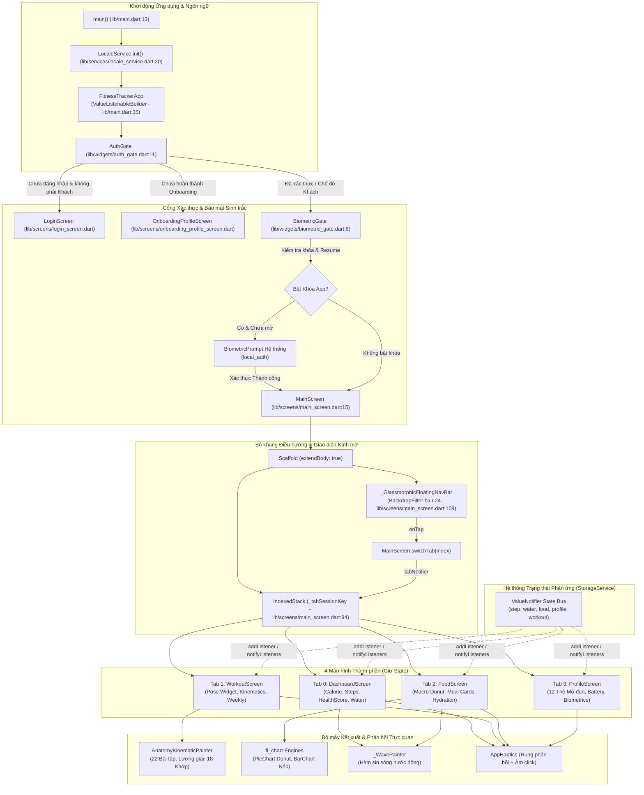

# Phân tích Kiến trúc Giao diện UI (W5)

## 1. Tóm tắt
Giao diện người dùng (UI) của dự án Fitness Tracker được xây dựng theo ngôn ngữ thiết kế Hiện đại Đậm chất Thể thao (Neo-Dark OLED Athletic Design), áp dụng bảng màu tương phản cao trên nền đen tuyệt đối (`0xFF000000`), hệ thống bo góc squircle chuẩn Figma (`figma_squircle`), hiệu ứng kính mờ động học (`BackdropFilter`) và phản hồi xúc giác tinh tế (`AppHaptics`). Kiến trúc điều hướng 4 tab sử dụng `IndexedStack` để bảo toàn trạng thái, được bảo vệ qua hai lớp cổng phân quyền (`AuthGate` và `BiometricGate` với `WidgetsBindingObserver`). Toàn bộ hoạt cảnh mô phỏng cơ bắp và động học khớp được tự dựng bằng `CustomPainter` toán học lượng giác thay vì nạp file Lottie tĩnh, kết hợp biểu đồ phân tích chuyên sâu qua `fl_chart`.

## 2. Chức năng

| Chức năng | Mô tả ngắn | file:line |
|---|---|---|
| **Hệ thống Design Tokens & Dark Theme** | Định nghĩa tập trung bảng màu OLED (`AppColors`), khoảng cách (`AppSpacing`), bo góc liên tục squircle (`AppRadius`), phông chữ Google Fonts Plus Jakarta Sans và cấu hình toàn cục `AppTheme.darkTheme`. | `lib/theme.dart:6-37,39-48,51-69,81-170` |
| **Cổng xác thực & Phân bổ luồng (AuthGate)** | Phân định trạng thái người dùng (Đã đăng nhập Google, Khách vãng lai, hay Chưa đăng nhập) kết hợp kiểm tra hoàn thành Onboarding; sử dụng `KeyedSubtree` để làm mới hoàn toàn cây giao diện theo phiên `sessionKey`. | `lib/widgets/auth_gate.dart:14-36,40-70` |
| **Cổng khóa sinh trắc học (BiometricGate)** | Giám sát trạng thái ứng dụng qua `WidgetsBindingObserver`. Khi người dùng rời ứng dụng và quay lại (`AppLifecycleState.resumed`), tự động kích hoạt `BiometricPrompt` bảo vệ dữ liệu cá nhân. | `lib/widgets/biometric_gate.dart:16-38,40-60` |
| **Điều hướng 4 Tab & Thanh Dock Kính mờ** | `MainScreen` quản lý 4 màn hình chính qua `IndexedStack`, tích hợp dock điều hướng nổi kính mờ (`BackdropFilter` blur 24px) và cho phép mọi widget con kích hoạt chuyển tab từ xa qua `MainScreen.tabNotifier`. | `lib/screens/main_screen.dart:18-30,91-104,109-140` |
| **Bảng điều khiển sức khỏe (Dashboard)** | Ghép nối dạng mô-đun các thành phần: Bản tin AI buổi sáng, Thấu kính cân bằng calo (Hero), Điểm sức khỏe toàn diện, Đếm bước chân trực tiếp, Biểu đồ calo 7 ngày, Nhật ký ăn nhanh và Nhắc uống nước. | `lib/screens/dashboard_screen.dart:22-60,482-530` |
| **Trung tâm tập luyện & Lọc thiết bị** | Quản lý danh mục bài tập gym/bodyweight, bộ lọc dụng cụ (Tạ đơn / Trọng lượng cơ thể), biểu đồ tuần `WeeklyActivityWidget`, thẻ gợi ý AI Coach và bản đồ giải phẫu nhóm cơ. | `lib/screens/workout_screen.dart:18-47,49-90` |
| **Màn hình tập luyện thời gian thực** | Điều khiển phiên tập với 2 chế độ (Đếm giờ hoặc Đếm số hiệp/reps), quản lý đồng hồ nghỉ kết nối thông báo hệ thống, theo dõi tiến trình tăng tiến tải trọng (Progressive Overload) và kỷ lục cá nhân (PR). | `lib/screens/active_workout_screen.dart:47-95,138-172,423-429` |
| **Trung tâm dinh dưỡng & Bữa ăn (FoodHub)** | Trực quan hóa dinh dưỡng với biểu đồ Donut 3 chỉ số đa lượng (Protein/Carbs/Fat), thanh chọn món ưa thích, 4 thẻ bữa ăn (Sáng, Trưa, Tối, Phụ) và khối theo dõi nước uống dạng sóng động. | `lib/screens/food_screen.dart:203-275` |
| **Thẻ danh mục bữa ăn mở rộng & Đa phương thức** | Cho phép mở rộng/thu gọn danh sách món, hỗ trợ nhập liệu bằng hình ảnh AI (`image_picker`), giọng nói (`speech_service`), quét mã vạch và lắng nghe `foodUpdateNotifier` để tự đồng bộ. | `lib/widgets/meal_category_card_widget.dart:16-59` |
| **Hồ sơ cá nhân & Hệ sinh thái 12 thẻ mô-đun** | Phân tách 12 thẻ chức năng độc lập (Hero, Macro, Mục tiêu, Sinh trắc, Pin, Health Connect, Đồng bộ Cloud, Ngôn ngữ,...); theo dõi sự kiện `resumed` để kiểm tra quyền miễn trừ pin. | `lib/screens/profile_screen.dart:32-60`, `lib/screens/profile/*.dart` |
| **Động học giải phẫu khớp 2D (Kinematics)** | `AnatomyKinematicPainter` giải lập chuyển động 22 bài tập bằng hình học lượng giác vi phân (tọa độ 18 khớp xương, góc nghiêng cơ thể, dụng cụ tạ đơn/xà đơn), hỗ trợ chuyển đổi giới tính Nam/Nữ. | `lib/widgets/anatomy_kinematic_painter.dart:96-155,2220-2225` |
| **Hoạt ảnh pose bài tập tương tác** | Điều khiển chu kỳ lặp lại bài tập qua `AnimationController`, cho phép tua nhanh/chậm (`0.5x`, `1.0x`, `1.5x`), tạm dừng và kéo thanh trượt điều chỉnh pha chuyển động theo thời gian thực. | `lib/widgets/exercise_pose_widget.dart:666-725,763-785` |
| **Bản đồ giải phẫu cơ bắp (Muscle Map)** | Cung cấp hình bóng cơ thể người 2D (`_AnatomySilhouettePainter`) và các đường chỉ dẫn tương tác (`_AnatomyLeaderLinesPainter`) kết nối vị trí giải phẫu tới các thẻ thông tin nhóm cơ (mặt trước/sau). | `lib/widgets/muscle_anatomy_map_widget.dart:9-31,1081,1201` |
| **Hiệu ứng sóng nước tương tác (Hydration Wave)** | Sử dụng hàm sóng lượng giác sin để mô phỏng mực nước dâng động học bên trong bình chứa, đồng bộ thời gian thực theo lượng nước uống nạp vào qua `AnimationController` lặp 2 giây. | `lib/widgets/hydration_wave_widget.dart:16-42,353-393` |
| **Biểu đồ cột so sánh Calo Nạp/Tiêu** | Sử dụng thư viện `fl_chart` hiển thị biểu đồ cột kép so sánh Calo Nạp và Calo Tiêu thụ trong 7 ngày gần nhất, tích hợp tooltip tương tác cảm ứng và nhãn trục Y thông minh (đơn vị k-kcal). | `lib/widgets/weekly_calorie_bar_chart.dart:14-60,128-175` |
| **Biểu đồ tròn tỉ lệ Macro Donut** | Hiển thị cơ cấu phân bổ calo đạm, đường, béo qua `PieChart` với tâm rỗng (Donut Chart) và hỗ trợ tự động tính mục tiêu dinh dưỡng theo hồ sơ thể trạng người dùng. | `lib/widgets/macro_donut_chart_widget.dart:18-50,213-248` |
| **Hệ thống phản hồi xúc giác & Âm thanh xúc cảm** | Module `AppHaptics` điều phối các mức độ rung phần cứng (`light`, `medium`, `heavy`, `selection`, `success`) kết hợp âm thanh nhấp chuột và cảnh báo hệ thống của thiết bị Android. | `lib/utils/app_haptics.dart:3-58` |
| **Cơ chế chuyển đổi đa ngôn ngữ tức thời** | Quản lý từ điển JSON i18n (`assets/i18n/*.json`), sử dụng `ValueNotifier<String>` kích hoạt làm mới `MaterialApp` thông qua `ValueKey(langCode)` mà không cần khởi động lại ứng dụng. | `lib/services/locale_service.dart:8-60`, `lib/main.dart:35-46` |

## 3. Kỹ thuật Android/Flutter

| Kỹ thuật / API | Cách dùng trong dự án | file:line | API level / Quyền liên quan |
|---|---|---|---|
| **`CustomPainter` & Lượng giác Canvas** | Vẽ trực tiếp đồ họa vector, đường cong Bezier, tính toán tọa độ khớp xương động học (`head`, `elbow`, `wrist`, `knee`, `ankle`) bằng `math.sin`/`math.cos` trên Canvas 2D. | `lib/widgets/anatomy_kinematic_painter.dart:96-155,2220-2225`, `lib/widgets/hydration_wave_widget.dart:353-393` | Skia / Impeller Rendering Engine |
| **`AnimationController` & Ticker** | Quản lý vòng đời hoạt ảnh mượt mà 60fps qua `SingleTickerProviderStateMixin`, điều khiển pha chuyển động lặp (`repeat()`) và thay đổi tốc độ playback linh hoạt. | `lib/widgets/exercise_pose_widget.dart:684-725`, `lib/widgets/hydration_wave_widget.dart:16-30` | Flutter Animation Framework |
| **`WidgetsBindingObserver`** | Lắng nghe sự kiện vòng đời tầng ứng dụng (`didChangeAppLifecycleState`), bắt trạng thái `AppLifecycleState.resumed` để kích hoạt khóa sinh trắc học hoặc tái kiểm tra cấu hình pin hệ thống. | `lib/widgets/biometric_gate.dart:16-38`, `lib/screens/profile_screen.dart:32-60` | Android Activity Lifecycle (`onResume`) |
| **`IndexedStack` & `KeyedSubtree`** | `IndexedStack` duy trì đồng thời State của cả 4 tab trên cây phần tử; `KeyedSubtree` với `ValueKey(sessionKey)` tiêu hủy và tái tạo cây màn hình khi chuyển đổi danh tính người dùng. | `lib/screens/main_screen.dart:94-98`, `lib/widgets/auth_gate.dart:15-35` | Flutter Widget Element Management |
| **`BackdropFilter` & Hiệu ứng Frosted Glass** | Áp dụng ma trận làm mờ `ImageFilter.blur(sigmaX: 24, sigmaY: 24)` phía trên nội dung cuộn để tạo hiệu ứng thanh điều hướng và BottomSheet dạng kính phủ mờ cao cấp. | `lib/screens/main_screen.dart:134-136`, `lib/widgets/app_ui_components.dart:422` | Khả năng tăng tốc phần cứng GPU |
| **`HapticFeedback` & `SystemSound`** | Gọi trực tiếp API native của Android (`HapticFeedback.lightImpact`, `heavyImpact`, `selectionClick` và `SystemSound.play`) nhằm tạo cảm giác bấm vật lý chân thực. | `lib/utils/app_haptics.dart:5-56`, `lib/widgets/app_ui_components.dart:33-50` | `android.os.Vibrator`, `android.media.AudioManager` |
| **`figma_squircle` (Continuous Corner)** | Thiết lập bo góc mượt mà kiểu iOS/Figma với hệ số làm mịn `cornerSmoothing: 0.6` qua `SmoothRectangleBorder` và `SmoothBorderRadius`, loại bỏ góc gãy của hình chữ nhật bo tròn truyền thống. | `lib/theme.dart:58-68`, `lib/widgets/app_ui_components.dart:120-129` | Thuật toán Squircle hình học vi phân |
| **`fl_chart` (Data Visualization)** | Tích hợp thư viện biểu đồ hiệu năng cao dựng cấu trúc cột kép (`BarChart`), miền phân đoạn đa lượng (`PieChart`), cấu hình trục tọa độ (`FlTitlesData`) và tooltip tương tác chạm. | `lib/widgets/weekly_calorie_bar_chart.dart:128-175`, `lib/widgets/macro_donut_chart_widget.dart:213-248` | Canvas Vector Graphics |
| **`ValueNotifier` Phản ứng tầng UI** | Sử dụng mẫu kiến trúc Reactive cơ bản không phụ thuộc bên thứ ba: phát tín hiệu cập nhật trạng thái dữ liệu (bước, nước, món ăn, hồ sơ) và đồng bộ tức thời giữa các widget con độc lập. | `lib/screens/main_screen.dart:18-29`, `lib/main.dart:35-44`, `lib/widgets/calorie_balance_hero_widget.dart:35-36` | Flutter Foundation (`ChangeNotifier`) |
| **Xử lý Vùng an toàn (Edge-to-Edge)** | Tính toán khoảng đệm thanh điều hướng cử chỉ của hệ điều hành Android qua `MediaQuery.of(context).padding.bottom` kết hợp `extendBody: true` để tạo cảm giác tràn viền hoàn toàn. | `lib/screens/main_screen.dart:93,120-130` | Android Navigation Bar Insets |
| **Hộp thoại đáy chuẩn (Modal Bottom Sheet)** | Tạo cấu trúc hộp thoại kéo cuộn hiện đại với tay nắm rê (`BottomSheetDragHandle`), nền kính tối mờ và bo góc squircle phục vụ nhập liệu nâng cao. | `lib/widgets/app_ui_components.dart:364-406,455-485` | Material Modal Presentation |

## 4. Luồng xử lý chính

Sơ đồ khối sau đây mô tả kiến trúc phân tầng giao diện, cơ chế bảo vệ phiên, hệ thống điều hướng 4 tab và luồng đồng bộ trạng thái phản ứng lên cây widget:



## 5. Hạn chế & rủi ro

- **Tải tính toán đồ họa cao trên Main Thread trong `AnatomyKinematicPainter`**: Toàn bộ thuật toán tính toán lượng giác của 18 khớp xương giải phẫu cho 22 bài tập được thực thi trực tiếp bên trong phương thức `paint()` tại mỗi khung hình 16ms (`lib/widgets/anatomy_kinematic_painter.dart:96-2225`). Trên các thiết bị Android cấu hình yếu, việc chạy song song hoạt ảnh này với tác vụ đọc cảm biến bước chân có thể gây hiện tượng rớt khung hình (Jank / UI Stutter).
- **Phụ thuộc thư viện không dùng (`lottie`) làm tăng kích thước bundle**: Trong `pubspec.yaml:43` có khai báo `lottie: ^3.6.1`, tuy nhiên toàn bộ mã nguồn giao diện trong `lib/` đều chuyển sang sử dụng `CustomPainter` tự dựng và không hề import hay sử dụng file `.json` Lottie nào.
- **Rủi ro rò rỉ bộ nhớ từ cơ chế quản lý State thủ công**: Dự án không dùng các bộ quản lý State chuyên nghiệp (như Bloc hay Riverpod) mà sử dụng 8 `ValueNotifier` độc lập trong `StorageService`. Mỗi StatefulWidget phải tự đăng ký `addListener` tại `initState` và hủy `removeListener` tại `dispose` (ví dụ: `lib/screens/dashboard_screen.dart:42,58`, `lib/screens/workout_screen.dart:68,74`, `lib/widgets/meal_category_card_widget.dart:52,57`). Nếu một màn hình bỏ sót bước hủy, listener sẽ bị treo vĩnh viễn gây memory leak.
- **Duy trì bộ nhớ nền liên tục của `IndexedStack`**: Việc sử dụng `IndexedStack` (`lib/screens/main_screen.dart:94-98`) giúp bảo toàn trạng thái cuộn và dữ liệu của cả 4 tab, nhưng đồng thời buộc ứng dụng phải giữ toàn bộ cây widget và các bộ đệm ảnh trong RAM, làm tăng mức tiêu thụ bộ nhớ (RAM footprint) của ứng dụng trên Android.
- **Tái tạo toàn bộ cây Widget khi đổi ngôn ngữ (`MaterialApp Rebuild`)**: `FitnessTrackerApp` sử dụng `ValueKey(langCode)` trên `MaterialApp` (`lib/main.dart:38-44`). Mỗi lần người dùng chuyển đổi ngôn ngữ Việt/Anh, toàn bộ cây giao diện bị hủy hoàn toàn và khởi tạo lại từ đầu, gây chớp nháy màn hình tạm thời thay vì chỉ cập nhật nội dung văn bản.
- **Giao diện chỉ hỗ trợ chế độ tối cố định (Hardcoded OLED Dark Mode)**: `AppTheme` chỉ cài đặt duy nhất `darkTheme` với nền đen tuyệt đối `0xFF000000` (`lib/theme.dart:100-168`), hoàn toàn không có `lightTheme`. Điều này gây bất tiện cho người dùng có nhu cầu sử dụng nền sáng dưới ánh sáng mặt trời mạnh.
- **Xung đột vùng cảm ứng cử chỉ đáy (Navigation Gesture Conflicts)**: Thanh dock điều hướng nổi kính mờ (`lib/screens/main_screen.dart:120-130`) sử dụng khoảng đệm `margin` cố định tính từ đáy màn hình. Trên một số phiên bản Android có thanh điều hướng 3 nút ảo cũ hoặc hệ thống cử chỉ tùy biến của hãng (MIUI/ColorOS), vị trí thanh dock có thể che khuất một phần nội dung cuối trang cuộn.

## 6. Gợi ý cho báo cáo

### Các mục báo cáo đề xuất đưa vào Đồ án:
1. **Chương "Thiết kế Giao diện & Trải nghiệm Người dùng (UI/UX)"**:
   - Trình bày hệ thống Design Tokens: Bảng màu OLED Athletic, tỷ lệ bo góc squircle chuẩn Figma (`SmoothBorderRadius 0.6` - `lib/theme.dart:58`), phân cấp kiểu chữ Plus Jakarta Sans.
   - Phân tích kiến trúc điều hướng 4 tab nổi bằng hiệu ứng kính mờ `BackdropFilter` và cơ chế chống mất State với `IndexedStack` (`lib/screens/main_screen.dart:94`).
2. **Chương "Đồ họa Vector, Động lực học Khớp & Trực quan hóa Dữ liệu"**:
   - Trình bày kỹ thuật tự xây dựng mô hình giải phẫu chuyển động người 2D bằng `CustomPainter` lượng giác (`lib/widgets/anatomy_kinematic_painter.dart:96-2225`), so sánh ưu/nhược điểm với hoạt ảnh Lottie tĩnh về mặt kích thước file và khả năng tùy biến giới tính/màu sắc.
   - Phân tích cơ chế tích hợp biểu đồ số liệu thể thao đa chiều thông qua `fl_chart` (BarChart kép Calo In/Out, Donut Chart dinh dưỡng đa lượng).
3. **Chương "Tối ưu hóa Vòng đời Ứng dụng & Tương tác Hệ thống"**:
   - Cách ứng dụng bắt sự kiện chuyển đổi vòng đời Android thông qua `WidgetsBindingObserver` để khóa sinh trắc học và kiểm tra quyền tối ưu hóa pin (`lib/widgets/biometric_gate.dart:34-38`, `lib/screens/profile_screen.dart:56-60`).
   - Kỹ thuật tạo trải nghiệm cảm ứng đa giác quan với rung phản hồi `AppHaptics` (`lib/utils/app_haptics.dart:3-58`).

### Danh mục câu lệnh ADB cần thực thi làm minh chứng:
```bash
# 1. Đo lường tốc độ khung hình và hiện tượng giật lag (UI Jank / Frame Rendering)
adb shell dumpsys gfxinfo com.nhh031.fitness_tracker framestats

# 2. Bật chế độ hiển thị vùng vẽ đồ họa GPU trên màn hình thiết bị thật
adb shell setprop debug.hwui.profile visual_bars

# 3. Kiểm tra ranh giới layout và padding Safe Area của hệ thống
adb shell setprop debug.layout true
adb shell service call activity 1599295570

# 4. Kiểm tra mức tiêu thụ bộ nhớ RAM của các View và bộ đệm đồ họa (Graphics/EGL)
adb shell dumpsys meminfo com.nhh031.fitness_tracker

# 5. Theo dõi logcat xử lý vòng đời ứng dụng và bộ điều phối giao diện
adb logcat -s flutter:V
```

### Danh mục ảnh chụp màn hình cần chuẩn bị:
1. **Ảnh Dashboard thể thao cao cấp**: Chụp màn hình chính hiển thị phối hợp giữa thẻ Calo Hero, số bước chân neon, bản tin AI và thanh Dock kính mờ (`lib/screens/dashboard_screen.dart:482-530`).
2. **Ảnh Mô phỏng Động học Khớp 2D**: Chụp hoạt ảnh chuyển động của người tập trong bài Đẩy ngực hoặc Squat được vẽ bằng `AnatomyKinematicPainter` kèm thanh điều khiển tốc độ `ExercisePoseAnimator` (`lib/widgets/exercise_pose_widget.dart:763-785`).
3. **Ảnh Bản đồ Nhóm cơ Tương tác (Muscle Anatomy Map)**: Chụp màn hình giải phẫu cơ thể người với các đường chỉ dẫn neon nối từ nhóm cơ ngực/lưng tới các nhãn thông tin (`lib/widgets/muscle_anatomy_map_widget.dart:1081,1201`).
4. **Ảnh Biểu đồ Phân tích Dinh dưỡng & Nước**: Chụp màn hình FoodHub hiển thị đồng thời biểu đồ Donut 3 chỉ số đa lượng Protein/Carbs/Fat và hiệu ứng sóng nước dâng `HydrationWaveWidget` (`lib/screens/food_screen.dart:203-275`).
5. **Ảnh Màn hình Tập luyện Thực tế (Active Workout)**: Màn hình bấm giờ bài tập tạ với thẻ thông số tăng tiến tạ Progressive Overload, ghi nhận kỷ lục PR và đồng hồ đếm ngược hiệp nghỉ (`lib/screens/active_workout_screen.dart:138-172`).
6. **Ảnh Cổng Khóa Sinh trắc học (BiometricGate)**: Hộp thoại vân tay hệ thống Android `BiometricPrompt` xuất hiện che phủ màn hình ứng dụng khi vừa mở lại từ chế độ nền (`lib/widgets/biometric_gate.dart:16-38`).
